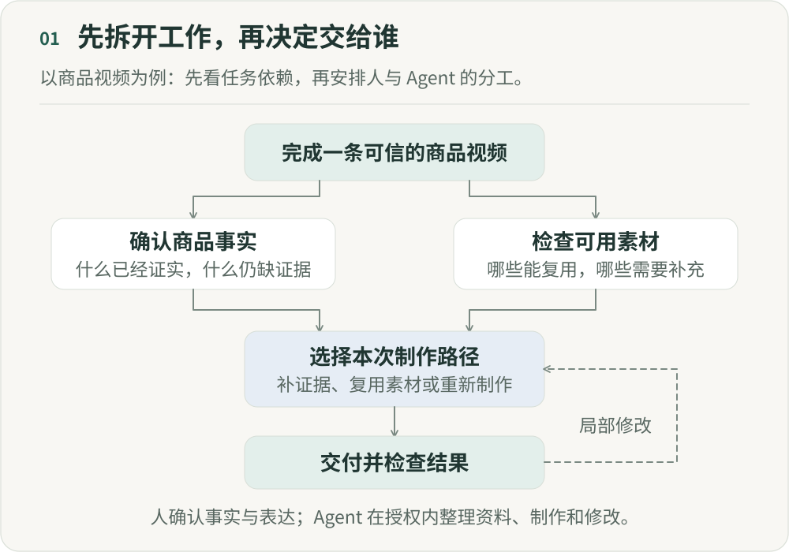

# 当“组织工作”本身也能被 AI 执行

**《重新组织》第一篇｜AI 时代的分工、权力与人的价值**

“帮我写一份报告。”

“判断这个问题需要调查什么，把不同方向交给合适的执行者，检查证据，发现缺口后重新安排工作，最后交付报告。”

这两条指令，交出去的东西已经不一样了。前者委派一项任务，后者还委派了部分关于任务应该怎样被完成的决定。

Anthropic 在公开的研究型智能体（Agent）系统中，已经采用这样的安排：主 Agent 制定调查策略，创建子 Agent 分头探索，再根据结果决定是否继续调查、补充方向或调整策略。这是特定研究任务中的工程实践，还不能代表一家公司的运行方式。[Anthropic](https://www.anthropic.com/engineering/multi-agent-research-system)

但它让一个变化变得具体：AI 开始参与拆解工作、分配注意力、协调执行与整合结果。它接走的已经不只是写作、搜索和分析。

如果“组织工作”本身也能部分交给 AI，原来围绕这些活动形成的岗位、流程和层级，还应该怎样安排？

## 一、组织问题，不等于组织架构

提到组织，我们很容易想到部门、岗位、负责人和汇报关系。但暂时拿掉这些名称，看看一件事为什么能够被一群人做成。

目标需要拆成可以行动的任务，任务需要有人承接，执行者也需要获得必要的信息。不同人的努力，还需要朝着共同结果汇合，而不是各自完成一份看似合格的作业。

Arrieta、Puranam 等人在工作论文《Multi-Agent AI Systems Are Organizations》中，把这类问题概括为任务分解、任务分配、信息供给，以及激励或目标配置。他们还强调，这些安排难免出错，需要能发现和处理异常。共同面对组织问题，并不意味着人和 Agent 应采用同一套解决办法。[工作论文](https://doi.org/10.2139/ssrn.6813862)

这个框架最有价值的地方，是帮助我们区分两件事：组织必须解决的问题，与我们习惯采用的解决方式。

需要协调，不等于必须召开周会；需要分配任务，不等于每一次都必须经过同一个负责人；需要专业判断，也不等于所有工作都必须沿着固定的部门顺序流转。

这些安排可能合理，甚至非常必要。但我们需要知道，它们究竟在解决什么问题。
否则，一旦技术条件变化，我们就容易只做两种选择：要么原样保留所有安排，只要求每个人更快；要么因为部分活动可以自动化，就把整个岗位或层级视为多余。

两种选择都跳过了最重要的分析。一位负责人可能同时承担进度追踪、资源协调、专业判断、冲突处理和成员培养。进度追踪可以部分自动化，并不能直接推出其他职责也应该取消。

能够重新分配的是具体活动，不能未经分析就把整个岗位当成可替换的零件。

## 二、新的不是把流程写进软件

这里需要先排除一个误解：把工作规则交给软件执行，并不是 AI 才带来的能力。

“满足条件就转给甲，否则转给乙”，用普通程序就可以实现。这样的系统执行的是事先确定的安排。

Agent 带来的另一种可能，是把部分安排留到任务发生时再决定。

Anthropic 在《Building Effective Agents》中区分了预定义工作流与 Agent：前者沿着预先写好的路径组织模型和工具，后者由模型动态决定过程与工具使用。它也明确强调，复杂性需要有实际收益，不能因为可以使用 Agent，就放弃更简单、可预测的方案。[Anthropic](https://www.anthropic.com/engineering/building-effective-agents)

从组织视角看，两者的差别可以这样理解：过去，我们先设计一条路，再让系统带着每项任务走完。现在，在某些边界明确、反馈可获得的任务中，我们可以给出目标、约束和可用资源，让系统参与判断这一次应该怎么走。

这并不意味着它可以任意改变目标，也不意味着它安排得一定比人好。

变化在于，“如何安排这项工作”本身，开始成为可以委派、检验和修正的任务。

以一条商品视频为例，如果素材已经齐全，就不必重新生成；如果关键卖点缺少证据，就应该先补充信息，而不是立即写脚本；如果修改只影响字幕，就不需要让所有环节重新执行。

这些判断当然也可以由人作出。值得研究的是：其中哪些能够稳定地交给系统，哪些仍需要人的介入，以及这种调整是否真的减少了总成本。

判断是否值得委派，需要把检查、纠错、模型调用和维护规则的成本一起算进去。省下沟通时间，却增加更多返工，组织未必获得收益。

## 三、不必先复制一家“数字公司”

沿着这条思路，可以做一个设计推演。

假设我们要建设一个内容生产系统。最直观的做法，是按照现有岗位，分别建立策划 Agent、编导 Agent、设计 Agent、剪辑 Agent，再安排它们依次交接。

这样的设计容易理解，但它隐含了一个未经检验的假设：原来适合人的工作边界，也适合 AI。

我们可以暂时放下岗位名称，重新描述任务：这条内容需要传达什么？哪些商品信息已经得到确认？有哪些可以复用的素材？什么地方需要探索，什么地方必须保持一致？什么证据足以支持一次修改？

另一种安排是，系统先检查信息与素材。缺少商品证据，就请求补充；证据充分，就围绕不同表达方向生成候选。创作者选定方向后，再完成相应的画面、声音与剪辑。发生修改时，只重新处理受影响的部分。

这仍然需要创作判断，也仍然存在专业分工。但我们不必事先假定，每一项工作都要经过一套完整的“数字部门”。

这里的变化，不是把人从流程里删除，而是把必须存在的任务依赖，与沿用已久的岗位交接区分开。

例如，确认商品事实，是创作必须遵守的约束；至于由哪个岗位先写出哪份文档，再把它交给谁，则可以重新设计。

当然，按照岗位建立 Agent 并不一定错误。它可能便于理解、明确责任，也可能适合既有业务接口。

需要避免的是：把组织图直接翻译成 Agent 图之后，就以为完成了重新组织。

我们应该先证明这种划分有用，而不是因为它熟悉，就默认它正确。

## 四、组织问题没有消失，只是换了出现的位置

把执行者换成 AI，并不会自动获得良好的协作。

Anthropic 在研究型 Agent 系统的工程复盘中提到，模糊的任务说明曾让子 Agent 重复调查、遗漏必要内容。改进不仅依赖模型能力，也依赖更清楚的目标、输出要求、工具指引和任务边界。[Anthropic](https://www.anthropic.com/engineering/multi-agent-research-system)

这类失败很有启发。当两个 Agent 各自完成任务，却无法把结果拼起来，我们不能只问哪个模型不够聪明。还需要检查：任务是否拆错了？双方是否掌握了不同版本的事实？输出是否满足彼此的需要？

从这个角度看，一部分看似纯技术的配置，也在规定协作关系。

给谁开放什么工具，是在设定行动范围；让谁读取哪些信息，是在决定它能够依据什么作判断；规定什么情况下必须请求确认，是在划定自主行动的边界。

这些配置会影响实际的工作关系，值得和岗位、协作方式一起讨论。

回到内容生产的例子：让 AI 建议替换一个镜头，与允许它直接替换、覆盖并发布，可能使用相同的模型，却是两种不同的授权安排。

提出建议、在批准后执行、在授权范围内自主行动，是不同的安排。本文所说的 Agent，指能够调用工具并参与选择执行路径的系统；它能做什么，仍取决于具体工具和授权。模型在测试中表现更好，并不自动改变这些权限。第六、七篇会继续讨论决定权和责任。

我更愿意把这类变化理解为：部分组织活动进入了软件，设计者仍要对其中的协作关系负责。

过去需要讨论的分工、边界与例外，现在可能被写进配置、提示词、代码和评估标准。改变其中一项，实际工作关系就可能发生变化，即使组织架构图一笔未动。

## 五、系统越能行动，越不能把目标当成理所当然

到这里，很容易得出一个过于整齐的分工：人提出目标，AI 负责组织执行。

这可以是某类任务的安排，却不足以描述一个完整的组织，因为目标本身也可能需要被讨论和修正。

仍以内容生产为例。假设系统被要求最大化点击率，它可能选择更强烈的表达。但创作者认为，这种表达虽然符合字面要求，却损害了品牌希望建立的关系。

此时，问题不是把某个环节做得更准确，而是我们究竟在追求什么？什么代价可以接受？谁有权提出异议？

这些问题不能只通过“模型有没有理解指令”来解释。

AI 可以帮助比较目标、分析取舍、提出新方向，但这不意味着一个指标一旦被写进系统，就自然获得了代表所有人的资格。

Puranam 在另一篇文章中提出，组织设计需要同时关注目标实现，以及人愿意参与其中的社会环境，包括自主性、连接感和能力成长。他并不把后者视为效率之外可有可无的补充。[INSEAD Knowledge](https://knowledge.insead.edu/leadership-organisations/organisations-age-algorithms)

这提醒我们：人的位置，不应该只剩下系统出现异常时的处理入口。

一个创作者应当能够质疑表达方向，而不只是修补画面。一个工程师应当能够指出目标本身的问题，而不只是确认代码是否通过测试。一个成员也应当有机会参与改变规则，而不只是接受越来越精确的任务分配。
否则，我们可能建设出一种运行顺畅、却不允许参与者影响其方向的工作系统。

它完成了更多任务，但是否构成更好的组织，仍然需要回答。

## 六、重新组织，从拆开“问题”与“形式”开始

《Multi-Agent AI Systems Are Organizations》提出的是一种研究视角，还不是一套已经验证成功的企业改造方案。组织问题有共通之处，怎样解决，仍取决于行动者的特点与具体条件。[INSEAD](https://www.insead.edu/faculty-research/publications/working-papers/multi-agent-ai-systems-are-organizations)

所以，这个系列想先看看那些习以为常的安排：一个审批环节是在补充判断，还是只在传递信息？一次专业交接保护了什么质量，又有多少只是过去工具留下的边界？一个必须由人负责的结果，是否要求所有中间步骤都由人逐一操作？

这些问题没有统一答案。AI 能够接走的，是经过授权、可以检验的一部分组织活动；什么样的组织值得建立，仍需要我们共同决定。

当软件开始参与安排工作，设计软件的人，也在参与设计组织。除了怎样完成任务，我们还要关心谁能作出决定，谁能纠正决定，以及身处其中的人，是否仍有能力改变工作的方向。

## 参考来源

- Anthropic. [How we built our multi-agent research system](https://www.anthropic.com/engineering/multi-agent-research-system), 2025-06-13。研究任务中的工程经验。
- Anthropic. [Building effective agents](https://www.anthropic.com/engineering/building-effective-agents), 2024-12-19。工作流与 Agent 的工程分类。
- Jose Arrieta, Vivianna Fang He, Phanish Puranam, Yash Raj Shrestha. [Multi-Agent AI Systems Are Organizations](https://doi.org/10.2139/ssrn.6813862), 2026, INSEAD Working Paper 2026/49/STR。组织研究视角与异常处理。
- Phanish Puranam. [Organisations in the Age of Algorithms](https://knowledge.insead.edu/leadership-organisations/organisations-age-algorithms), 2025-02-24。目标实现与人的社会环境。

---

## 图解

目标是完成一条可信的商品视频。先分别确认商品事实和检查可用素材，两类信息共同决定本次制作路径：补充证据、复用素材或重新制作。交付后检查结果，只重新处理受影响的部分。人确认事实与表达，Agent在授权内整理资料、制作和修改。

作者：LeenMa。原创内容采用 [CC BY 4.0](../LICENSE)。

[文章目录](../README.md) · [下一篇：02](02-teams.md)
