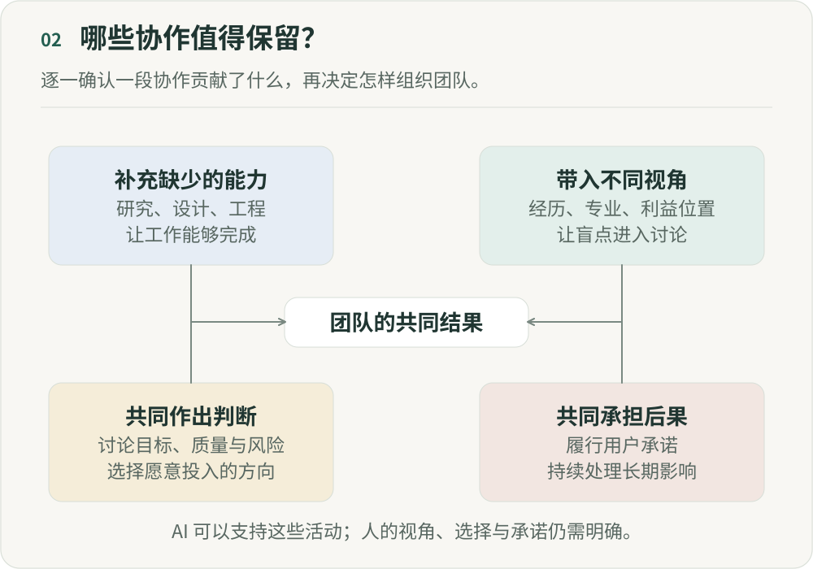

# 超级个体之后，为什么还需要团队？

**《重新组织》第二篇｜AI 时代的分工、权力与人的价值**

一个产品经理可以自己做原型，一个设计师可以让 AI 帮他写前端，一个工程师也能让智能体（Agent）帮他研究用户、分析竞品、生成方案。一个导演甚至可以带着几个生成模型，完成过去需要编剧、美术、摄影、剪辑共同完成的一部分工作。当一个人的能力边界不断扩大，我们为什么还需要团队？

“因为 AI 还不够强”是一个很容易想到的答案。今天，它确实不能完全替代设计师、工程师或者导演。但如果我们相信它的能力还会继续增长，这个答案就只是把问题推迟了：等 AI 足够强以后呢？我想从这里往下追问：团队究竟在解决什么问题？

## 一、过去，我们为什么需要把不同的人放在一起？

在一个没有 AI 的产品团队里，产品经理理解需求，设计师把需求变成体验，工程师把方案变成软件，数据同学观察结果，运营把产品推向用户。需要这么多人，一个直接原因是知识和能力分散在不同的人身上。产品经理不会写所有代码，工程师不一定擅长交互设计，设计师也未必理解模型训练、数据分析或者商业策略。

团队因而像一块能力拼图：每个人贡献自己掌握的部分，共同完成一个人做不了的事情。AI 正在改变这块拼图。

## 二、AI 扩大了可以按需调用的能力范围

招聘、外包和专业软件，早已让团队能够使用自己不具备的能力。AI 扩大了这种选择：更多写作、编程和分析任务，可以通过描述目标来启动，获取初步结果的成本也可能下降。

今天多了一种选择。不会写前端，可以调用编程 Agent；不擅长视觉设计，可以让模型生成多个方向；不了解一个行业，可以让研究 Agent 搜集资料；身边没有分析师，也可以先让 AI 帮忙探索数据。

这些能力还远非完全可靠，但获取能力的方式已经开始变化：不一定要自己掌握，也可以按需调用。传统团队的一部分结构，本来就是围绕谁掌握什么能力建立的，这种变化因而可能比提效影响更深。

还需要为了获得某种能力，把一个人长期放进团队吗？这里需要检查的，是团队存在的理由有多少来自能力稀缺；它本身还不是裁员的依据。

## 三、一个实验，已经让这个问题变得不再抽象

2026 年发表于《Organization Science》的《The Cybernetic Teammate》，研究了宝洁专业人员完成产品创新任务的表现。这项预注册现场实验，把参与者随机分配到单人或两人团队、可以或不可以使用生成式 AI 的条件。[正式发表版](https://doi.org/10.1287/orsc.2025.20702)

在这项任务的表现评价中，使用 AI 的个人与不使用 AI 的两人团队表现相当。使用 AI 的方案也更能兼顾技术与商业考虑。研究同时指出，人类判断对创意的评估和选择仍有价值。

这不能推出“一人公司已经到来”。实验研究的是边界清楚的产品创新任务，不是长期经营公司。它给我的启发是：如果 AI 能提供一部分知识互补，团队还有哪些价值需要由人共同完成？

## 四、这时候，我们会发现：团队其实一直承担着四种完全不同的功能

过去，这些功能经常被混在“协作”里。现在可以把它们拆开看。

### 第一种：能力互补

你会产品，我会设计，他会工程，大家把能力拼起来完成任务。这一层最容易受到 AI 影响：个人能力半径扩大，过去必须跨岗位完成的事，可能交给一个人和 AI 就能完成。因为“我不会”而产生的协作，也可能减少。

### 第二种：认知差异

两个同样会写代码的人，可能对架构判断不同；两个都懂内容的人，也可能有不同的审美。遇到困难问题，我们常常连正确答案是什么都不知道，这时需要的是另一种看问题的方式。

AI 可以生成不同观点、扮演反方。但人的经历、专业训练、利益位置和价值观形成的差异，不会自动因此失去价值。把人放在一起，除了组合技能，也可能是为了让这些差异进入讨论。

### 第三种：共同判断

假设 AI 一次生成 100 个产品方向，接下来要选择哪一个？生成成本下降，并不意味着判断也变得容易。

产品要不要做，体验够不够好，点击率更高的内容会不会损害品牌，短期商品交易总额与长期用户关系怎么取舍，都需要信息和模型，也涉及风险偏好、价值选择和对未来的判断。团队的一部分价值，可能由共同生产转向共同判断。

### 第四种：共同承担

长期组织里还有承诺：我们共同选择一个方向，也承担它的后果。项目失败以后，人仍然要面对用户、同事、客户、投资人和彼此，不能像 Agent 一样关闭后再生成一个新方案。

“我们决定一起做这件事”，包含了技能组合解释不了的关系。这种承诺需要具体的人和制度来维持。把执行交给 Agent，不会自动转移面对用户、同事和客户的责任。

## 五、所以未来团队真正减少的，可能不是“人”，而是低价值协作

产品写产品需求文档给设计，设计交给工程，工程再找测试，每次交接都需要解释和等待，也可能损失信息。过去我们接受这些成本，因为专业能力分散在不同岗位。

如果产品经理已经能做出可运行的演示原型，工程师能理解需求并修改体验，创作者能独立完成从脚本到成片的大部分工作，就值得重新检查这些交接的必要性。

这不意味着产品、设计、工程变成了同一个岗位。增加专业判断、带来不同认知，或共同承担高风险决定的协作，仍有价值。更容易被 AI 改变的，是那些只有传递和重复执行、没有增加新判断的交接。

## 六、未来最小的组织单元，可能不是岗位，而是一个完整结果

过去设计团队，经常先问需要几个产品、设计、前端、后端和算法。我越来越想把问题倒过来：这个团队需要独立完成什么结果？

围绕结果，再判断哪些能力需要长期存在，哪些可以从共享平台调用，哪些交给 Agent，哪些判断需要不同专业互相挑战，哪些决定需要共同承担。

这样的团队可以把长期协作的成员、Agent、外部专业服务和共享基础设施组合起来。组合是否有效，要看工作依赖是否清楚、结果能否检验，以及增加的协调成本是否值得。

人数未必一定减少。AI 降低探索成本，也可能让团队去做过去不敢尝试的事情，需要更多人。需要重新回答的，是每个人为什么属于这个团队。

## 七、超级个体，不应该成为组织的终点

“超级个体”描述了一个有吸引力的场景：一个人带着几十个 Agent，写代码、做产品、生成内容、分析数据、运营公司。个人的生产边界正在扩大。但我不认为，组织最终就应该只剩下一群超级个体。拥有更多能力，不会自动让一个人拥有所有视角。面对不确定性、价值冲突、认知盲区和长期承诺，我们仍然需要一个人无法独自拥有的现实经验。

所以我更愿意这样理解未来团队：AI 减少因为能力缺失而被迫发生的协作，让我们把人类协作留给需要不同判断、共同创造和共同承担的地方。团队可能变大，也可能变小。每一次把人放在一起，都应该有一个比“流程规定如此”更好的理由。

## 参考来源

- Fabrizio Dell’Acqua 等. [The Cybernetic Teammate: A Field Experiment on Generative AI and Teamwork](https://doi.org/10.1287/orsc.2025.20702), Organization Science, 2026。本文使用正式版的产品创新任务结论，不将其外推为长期团队替代效果。

---

## 图解

团队围绕共同结果发挥四类作用：补充缺少的能力，带入不同视角，共同作出判断，以及共同承担后果。AI可以支持这些活动，但需要明确谁带入了哪些视角、谁参与选择、谁持续承担承诺。仅仅传递信息的交接可以检查是否有简化空间。

作者：LeenMa。原创内容采用 [CC BY 4.0](../LICENSE)。

[文章目录](../README.md) · [上一篇：01](01-work.md) · [下一篇：03](03-judgment-leverage.md)
