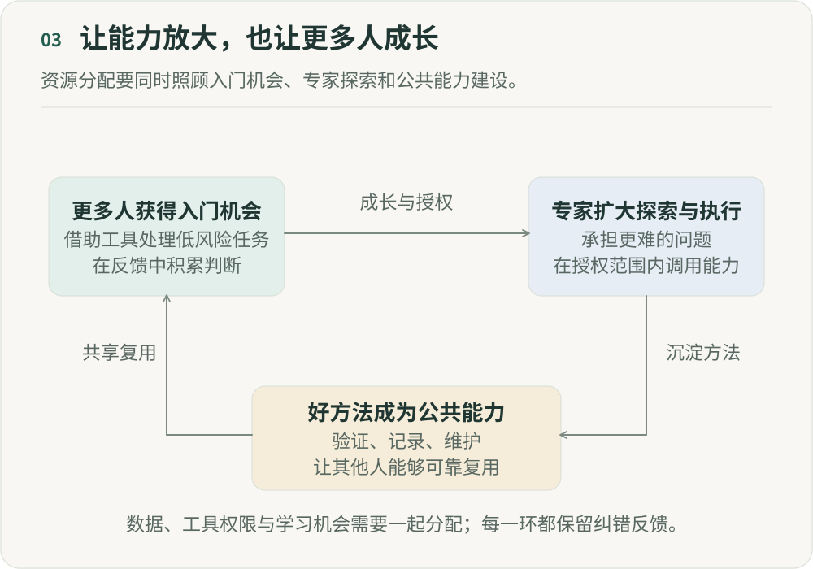

# AI 会拉平差距，还是放大强者？

**《重新组织》第三篇｜AI 时代的分工、权力与人的价值**

关于 AI，我们正在同时听到两种故事。一种是能力民主化：不会写代码的人可以做产品，不会设计的人可以生成视觉，没有研究背景的人也能快速进入陌生领域。过去需要多年训练才能跨越的专业门槛，正在降低。另一种是超级个体：优秀工程师可以同时推进多个编程智能体（Agent）任务，成熟创作者可以让自己的审美和方法驱动更多内容生产。一个原本就很强的人，开始拥有过去只有一个团队才有的执行能力。

一个像在缩小差距，一个却在扩大差距。我认为两者都可能发生，区别在于 AI 被放在工作的什么位置，以及人获得的是帮助，还是杠杆。

## 一、第一阶段的 AI，确实在降低很多专业门槛

先看一个越来越常见的场景。一个产品经理过去想验证一个产品想法，需要先写需求，再找到设计师做页面，再找工程师开发演示原型。今天，他可能直接描述需求，让 AI 生成界面，再用编程 Agent 做出一个可以运行的版本。这不意味着他已经成为专业设计师或者工程师。

但有一件事发生了：原来因为“不会”而无法开始的工作，现在可以开始了。这就是 AI 最直观的能力民主化。类似的变化正在不同领域发生。英语不好，不再意味着很难阅读海外资料。不会 SQL，也可以探索数据。没有受过专业视觉训练，也能迅速生成几十种视觉方向。不了解一个行业，可以先让研究 Agent 建立基本认知。

过去需要先掌握技能才能开始的事情，现在可以先描述目标，再在执行过程中获得 AI 的帮助。很多传统分工，本来就是围绕专业门槛形成的：一个人做不了，就交给另一个人。当门槛降低，一部分因为“能力缺失”而产生的交接，也会减少。

但故事只讲到这里，就会产生一个非常诱人的结论：既然 AI 给每个人相同的能力，人与人的差距应该越来越小。

## 二、AI 可以缩小“会不会”的差距，却可能扩大“知道做什么”的差距

假设两个人同时得到世界上最好的编程 Agent。一个人几乎没有产品经验。另一个人做过十年产品，也理解技术。他们拥有同样的模型和模型调用额度，甚至使用同样的工具。最后的结果会一样吗？很可能不会。

因为当执行成本快速下降以后，新的瓶颈开始出现：你让 AI 做什么？什么问题值得解决？什么需求其实是伪需求？什么时候应该继续探索，什么时候应该停止？一个方案看起来不错，究竟哪里不对？AI 可以帮助回答这些问题。但要判断 AI 给出的答案是否值得相信，又需要另一层判断。

过去，差距很大程度体现在谁能做出来；未来则可能越来越体现在：谁知道什么值得做，以及什么才算做得好。一些执行任务更容易通过模型和工具获得，问题定义、审美、判断和取舍也因此更值得关注。这里的变化因任务而异，不能从生成一个原型的速度，直接推算可靠交付整个产品的成本。这也是为什么，同一个模型落在不同的人手里，最终可能产生完全不同的杠杆。

## 三、辅助人工作与自主执行，会带来不同的影响

Enrique Ide 和 Eduard Talamàs 在《Artificial Intelligence in the Knowledge Economy》中，用知识层级模型分析 AI 的分配影响。模型中的人具有不同知识水平和时间约束；AI 可以只帮助人解决问题，也可以自主承担生产任务。[论文与作者稿](https://arxiv.org/abs/2312.05481)

在他们构建的理论模型中，两类 AI 可能产生不同的分配结果。辅助型 AI 更可能帮助原本知识较少的人，填补“我不知道怎么做”的缺口。能够独立执行的 AI，则可能给高知识水平者带来更大杠杆，缓解“我知道该怎么做，但时间有限”的限制。

这是一种关于组织和收入分配的理论解释，结果取决于模型中的知识差异、时间约束和 AI 能力。现实产品被称为“助手”或“Agent”，并不足以判断它会带来哪一种分配结果。下文关于问题定义、审美、资源和反馈的讨论，是我对实践的延伸。

## 四、真正的超级个体，不是“什么都会”，而是拥有越来越大的杠杆

我们很容易把超级个体想象成一个什么都会的人：产品、设计、代码、运营、内容，技能越装越多。我现在更关心的是，他能让自己的判断驱动多少执行能力。定义问题、判断方向、调用能力，把任务交给 Agent，再检查结果、必要时重新组织执行，这些活动不要求他亲自掌握所有技能，却要求他能判断工作的方向和质量。

一个优秀工程师一天仍然只有 24 小时。但如果五个编程 Agent 同时探索不同方案，他的判断就可能作用于五条执行链。一个导演过去需要几十个人把创意变成画面，未来，他的一部分意图可以直接驱动图像、视频、声音与剪辑模型。这里的杠杆，是让一份判断作用于更多执行。它也有上限：并行任务越多，核对结果、处理冲突和纠正错误所需的时间可能越多。能启动多少 Agent，与能可靠地协调多少工作，并不是同一个数字。

## 五、但杠杆越大，错误也会被一起放大

一个好判断被 Agent 执行一百次，价值可能被放大；一个错误判断被执行一百次，错误也会被放大。过去，一个人的错误受执行速度限制，这个限制正在消失。

假设一个内容负责人错误理解了用户。过去，团队一周做十条内容；现在，系统一天就能生成一千条。从生产指标看，效率提高了几十倍；从结果看，却是在更快、更大规模地做错事情。

会使用 Agent 之外，还需要一个反馈系统，让人知道自己什么时候错了。判断力不能只被理解成天才直觉。它需要接触用户和数据，接受不同专业的挑战，允许别人说“不”，也让系统暴露失败。没有这些反馈，超级个体也可能只是被 AI 放大的认知偏差。

## 六、相同的工具入口，未必意味着相同的行动能力

如果 AI 只是个人助手，组织可以先让更多人拥有编程助手、研究 Agent 和数据分析能力。这是能力普惠。

当 AI 能自主执行任务，稀缺的东西可能就不只是 Agent：谁可以创建它，调用哪些数据，执行什么真实动作？谁拥有算力，能把自己的方法沉淀成全公司可调用的技能模块，又能同时调度十个、几十个甚至几百个执行单元？

这些权限和资源，决定了组织如何分配生产杠杆。表面上“人人都有 AI”，仍然可能存在很大的能力不平等。每个人都有聊天窗口，并不意味着拥有同样的行动能力，就像能使用互联网，也不意味着控制着相同的资本、渠道和组织资源。

因此，除了 AI 渗透率，还需要看 AI 杠杆究竟分布在谁手里。

## 七、组织有三种不同的选择

企业部署 AI 并不是一条单向路线。沿着前面的讨论，至少可以看到三种方向。

- **能力普惠。** 让更多人跨越专业门槛：产品经理可以做演示原型，运营可以分析数据，工程师可以做研究，创作者拥有更多制作能力。AI 帮他们减少“因为不会，所以必须等待别人”的情况。
- **专家放大。** 把 Agent、数据、工具和自动化能力集中给最有判断力的人，让优秀工程师同时推进更多项目、创作者控制更多生产能力、成熟业务负责人管理更大的执行范围。这里追求的是，让好的判断产生更大的影响。
- **组织能力公共化。** 把优秀个体的方法，逐渐变成整个组织可以调用的能力。例如，创作者判断商品卖点的方法可以做成可复用的技能模块，工程师排查线上问题的方法可以交给 Agent，团队积累的项目决策经验也可以进入组织记忆。

第三种方向值得探索，但不能只要求专家贡献方法。谁负责维护、其他人如何检验、贡献者怎样得到回报，都会影响它能否持续。第八篇会专门讨论这些条件。

## 八、AI 时代的人才竞争，可能从“拥有能力”转向“创造能力”

在分配资源时，我会同时观察直接交付和公共能力建设。一个人把排障方法做成工具，另一个人借此解决问题，价值发生在两人的工作之间。组织可以给前者明确的维护时间，给使用者报告错误和提出改进的渠道，再用真实结果决定是否扩大使用。

“专家”也不应成为永久免检的身份。更大的资源和权限需要持续反馈；新人的判断经过验证，也应有机会获得更大的行动空间。

## 九、所以，AI 最终会拉平差距，还是放大强者？

AI 可能拉平信息获取、基础执行和专业入门的差距，也可能扩大问题定义、判断质量、资源调度，以及把判断规模化的能力差距。对组织来说，能力普惠、专家放大和组织能力公共化，需要放在一起考虑。只有普惠，可能让很多人会用 AI，却没有形成新的优势；只放大专家，可能让组织越来越依赖少数人；只建设公共能力，却没有持续成长的个体，能力的来源也会枯竭。

我更期待的，是三者形成一个循环：AI 帮助更多人成长，优秀的人获得更大杠杆，好方法沉淀成公共能力，再帮助更多人成长。这条循环能否成立，要看组织怎样分配 Agent、权限、数据、算力和学习机会。今天的分配方式，已经在决定 AI 最终会拉平哪些差距，又放大哪些差距。

## 参考来源

- Enrique Ide, Eduard Talamàs. [Artificial Intelligence in the Knowledge Economy](https://doi.org/10.1086/737233), Journal of Political Economy, 2025；[作者稿](https://arxiv.org/abs/2312.05481)。知识层级与一般均衡模型，不是企业改造实验。

---

## 图解

AI帮助更多人跨越入门门槛。获得经验和反馈的人可以承担更难的判断，并在明确授权下扩大执行能力。经过验证的好方法被整理成公共能力，支持更多人继续成长。数据、工具权限和学习机会影响这个循环能否成立，每一环都需要纠错反馈。

作者：LeenMa。原创内容采用 [CC BY 4.0](../LICENSE)。

[文章目录](../README.md) · [上一篇：02](02-teams.md) · [下一篇：04](04-policy.md)
