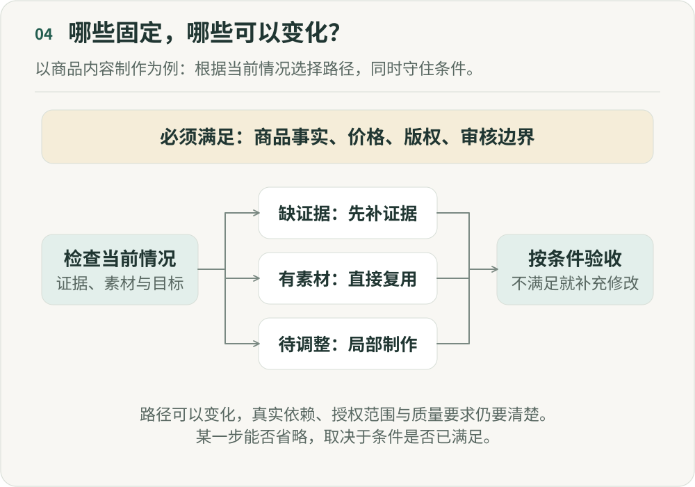

# AI 时代，我们还需要“流程”吗？

**《重新组织》第四篇｜AI 时代的分工、权力与人的价值**

假设一个新人刚进入公司，你交给他一个任务：“把这个页面做出来。”

通常这还不够。你可能需要继续告诉他需求是什么、采用什么方案、先做什么后做什么、找谁确认，以及什么情况下可以上线。于是，我们写产品需求文档、画流程图、制定标准操作流程、设置审批节点。

表面上，这些东西是在管理流程。但换一个角度看，它们其实是在替执行者提前完成一部分判断。

这让我最近重新理解了“流程”这件事。AI 时代真正发生变化的，可能不只是流程被自动化，而是过去必须由组织提前规定的“怎么做”，开始可以由执行者在运行时自己决定。

如果这个判断成立，我们就需要重新回答一个很基础的问题：AI 时代，我们到底还需要多少固定流程？

## 一、先理解一个模型：PSHE

Shishir Mehrotra 在公开的《Establishing Great: PSHE》中使用了 Problem、Solution、How、Execution 这四个词。借用这个划分，我们可以观察一项工作中哪些判断已经确定，哪些还需要执行者自己完成：[作者原页](https://coda.io/@shishir/pshe)

- **问题（Problem）：** 要解决什么问题？
- **方案（Solution）：** 选择什么方案？
- **方法（How）：** 具体怎么做？
- **执行（Execution）：** 把它执行出来。

一种常见的培养安排，是先给新人明确的问题、方案和方法，让他负责执行；随着经验增加，再把方法、方案乃至问题选择交给他。这里借它说明授权可以怎样变化，并不是说所有职业成长都要沿同一条阶梯前进。

所以，一个人的成长并不只是负责范围越来越大，也意味着别人替他完成的判断越来越少。

## 二、标准操作流程，是把已有判断交给后来的执行者

为什么公司需要流程？因为绝大多数执行者，并不能在所有情况下自己完成从发现问题到执行的全部工作。于是组织把优秀员工过去积累的经验写下来：遇到 A 执行 B，完成 B 进入 C，出现 D 升级给负责人；第一步做什么，第二步做什么，第三步找谁确认。这就是标准操作流程，通常简称 SOP。

它不只是工作步骤，也是在把过去的判断整理成方法，交给未来的执行者。这样，新人不需要每次重新思考，不同的人可以得到相对稳定的结果，管理者也不需要亲自参与每一次判断。

把少数人的经验，变成多数人可以执行的流程，是工业时代组织的一种重要扩张方式。麦当劳、制造业、软件工程都采用了这种方式。流程解决的不只是规范问题，也是在回应一个限制：判断能力无法无限复制。

## 三、Agent 正在改变这个前提

如果执行者本身开始拥有判断能力，会发生什么？

早期的 AI 更接近执行者。你告诉它“按照这个需求写代码”“根据这份文案生成图片”“把这份数据整理成表格”，人决定问题、方案和方法，AI 主要负责把它做出来。这种情况下，原来的流程基本不需要改变，我们只是拥有了一个更快的执行者。

但今天的编程智能体（Agent）已经越来越不像这样。你可以只告诉它：“这个功能有 Bug，找到原因并修掉。”它会自己阅读代码、搜索相关模块、提出假设、修改实现、运行测试，发现失败之后重新调整。它开始承担一部分选择方法的工作。

再往前一步，你告诉研究 Agent：“帮我判断这个市场值不值得进入。”它可能自己拆问题、寻找资料、比较不同解释，再形成几个可能的方案。AI 正从执行逐渐参与到规划和方案判断中。

这带来了一个组织问题：如果执行者已经能够自己选择方法，我们为什么还需要把所有做法提前写进标准操作流程？

## 四、工作流与 Agent，也在重新分配决定权

传统工作流由人提前规定方法和路径，机器沿着写好的步骤执行。Agent 则可以获得问题、部分方案、目标与边界，在运行过程中参与选择方法，再完成执行。

两者的区别也发生在授权上：过去，具体做法主要由流程设计者决定；现在，其中一部分可以交给正在处理任务的 Agent。决定权由此发生了迁移。

一旦决定权发生变化，组织设计就已经发生变化，即使组织架构图、部门和岗位一个都没有动。

## 五、先分清哪些步骤真的有必要

第一篇用商品视频说明了任务可以怎样重新组合。在这里，我想继续追问流程本身：修改字幕是否需要重新策划，已有素材是否需要再次生成，缺少卖点证据时又是否应该暂停创作？

有些步骤保护了质量，有些只是过去按岗位交接留下的安排。先说明每一步在防止什么问题，才能判断它能否调整。

## 六、可以调整步骤，不能忽略真实的依赖和约束

“既然 Agent 会规划，以后就不需要流程”，是另一个容易走到的极端。路径可以动态变化，真实的依赖和约束却不会因为 Agent 更聪明而消失。

一条商品视频可以跳过重新生成素材，可以先剪辑再补部分内容，也可以让几个 Agent 并行探索。但商品事实必须真实，价格必须正确，版权必须确认，高风险内容必须审核。这些必须满足的条件，与“先写脚本还是先做分镜”所规定的路径不同。

重新设计流程时，可以把三个问题拆开：

- **目标：** 究竟要实现什么结果？
- **依赖和约束：** 哪些条件必须满足，哪些事情存在真实的先后依赖？
- **执行路径：** 为了实现目标，这一次具体怎么走？

过去，我们经常把三者一起写进标准操作流程。Agent 时代，需要重新把它们拆开。

## 七、真正困难的，是哪些事情可以解耦，哪些必须一起变化

把路径动态化以后，还会遇到一个更深的问题：组织里的任务并不是彼此独立的。

假设过去营销每天固定投放 100 个商品，供应链知道大概需要准备多少库存，客服也能预估咨询量。这个系统未必局部最优，但因为大家相对稳定，所以容易协调。

现在 AI 可以实时预测哪个商品今天值得突然放大十倍流量。从营销视角看，这是更聪明的决策。但如果库存、物流、客服没有同时变化，局部更聪明反而可能制造系统问题。

所以，除了追求每一个 Agent 更聪明，还要分清哪些决定可以独立变化，哪些必须一起变化。

如果两个任务之间存在强依赖，就不能因为 Agent 可以自主规划，就假装它们已经解耦。

这也是为什么未来的组织设计，可能越来越像软件工程里的接口设计。

好的模块不是彼此完全不知道对方，而是清楚地定义：我给你什么、你返回什么、什么算成功、什么情况下失败、发生异常以后由谁处理。

组织也是如此。人与人、团队与团队、人与 Agent、Agent 与 Agent 之间，都需要越来越明确的接口，而不是越来越多的人同时参与所有信息。

## 八、从规定步骤，到明确行动规则

我越来越倾向于把这种变化理解为：从标准操作流程，走向明确的行动规则与授权边界，也就是这里所说的 Policy。

标准操作流程告诉执行者先做 A，再做 B，出现 D 就找负责人。行动规则则说明目标是什么、什么不能做、结果必须满足哪些条件、可以使用什么资源和权限，以及何时必须升级给人。具体路径，可以根据现实动态生成。

执行者先理解目标与当前情况，检查依赖和约束，再制定计划、采取行动，根据反馈重新规划。流程仍然存在，只是从预先规定每一步，逐渐转向规定边界，让路径动态生成。

两种安排对执行者的假设也不同：前者主要告诉执行者怎么做，后者承认执行者拥有一定判断能力，但要求它在明确边界内行动。规则引擎和自动化系统早已能按条件选择路径。Agent 增加的可能，是在边界内处理更多难以事先枚举的情况；这也增加了验证、观察和处理例外的要求。

## 九、把行动规则写到能够执行

“Agent 可以自行处理低风险问题”还不够具体。以退款为例，规则至少要说明可处理的订单类型、所需证据、金额范围、重复请求的处理方式，以及退款失败后由谁接手。这些条件需要由负责该业务的人确认。

在满足规则时，系统可以选择怎样收集信息；证据冲突、工具失败或超出授权时，则需要停止相关动作并转交明确的负责人。授权如何分配，留到第六篇展开；这一篇先把规则写到人和系统能够共同检查的程度。

## 十、AI 承担更多判断，不意味着人只能不断后退

如果 AI 从执行走向选择方法和方案，是不是最后人只剩下发现问题？再有一天，AI 连问题都能发现，人就没有位置了？我不这么理解。

“应该解决什么问题”并不是凭空出现的，它往往来自用户、市场、战略、价值观，以及组织所处的现实。很多问题之间还存在冲突：提高商品交易总额，还是保护长期用户体验？提高生产效率，还是给新人保留成长机会？更激进地使用数据，还是保护隐私？

工作也不是从问题、方案、方法一路走到执行就结束了。执行会改变现实，反馈又会让我们重新定义问题。因此，人未必需要永远守住 PSHE 中的某一层，而要参与整个循环，并保有质疑目标、修正问题和重新定义方向的能力。

这比“AI 负责执行，人负责思考”更准确。AI 也可以思考、规划和提出问题。真正需要讨论的是：哪些判断可以授权，哪些判断必须共同形成，以及最终谁有权改变目标。

## 十一、管理者未来设计的，可能不是流程，而是“自由度”

传统管理者很擅长处理一类问题：流程怎么设计？哪里增加审核？谁向谁汇报？出了问题补什么标准操作流程？

AI 时代，管理者还需要追问：这个任务究竟要解决什么问题？哪些方案可以让系统探索？哪些做法不值得提前规定，哪些执行可以完全自动化？什么约束绝不能突破，Agent 有权决定什么，又有哪些反馈会触发重新规划？

这些问题指向的，是边界内的自由。

自由度需要与任务相称。稳定、规则完整的工作，固定流程可能更经济；变化多、又能及时验证的工作，才更值得给执行者选择路径的空间。

真正好的设计，是找到那个边界：让执行者拥有足够的判断空间，同时让组织仍然能够控制不可接受的风险。

所以未来管理者最重要的能力之一，可能不是把流程设计得越来越完整，而是知道：什么应该固定，什么应该留白；什么可以动态决定，什么必须升级；哪些自由应该交出去，哪些责任必须同时跟上。

## 十二、AI 时代，我们还需要流程吗？

当然需要。只是越来越多时候，流程除了规定下一步怎么做，还需要说明谁有权决定下一步、依据什么事实、遵守什么边界，以及何时交给别人、怎样获得反馈。

从规定操作步骤到明确行动规则，从控制每一步到划分决定权，讨论的都是这件事：当执行者具备更多判断能力，组织应该提前规定多少，又该留下多少空间。

我想保留的并不是“流程越少越好”这个结论。能写清的依赖和约束仍要写清，需要人承担的责任仍要有人承担。在此基础上，把目标、边界和反馈设计好，让执行者有机会根据现实调整路径。

## 参考来源

- Shishir Mehrotra. [Establishing Great: PSHE](https://coda.io/@shishir/pshe), 2022。四词及署名可在作者页核对；本文的授权和 Agent 讨论是借用这个划分的延伸。
- Anthropic. [Building effective agents](https://www.anthropic.com/engineering/building-effective-agents), 2024-12-19。预定义路径与动态执行的工程区分。

---

## 图解

商品事实、价格、版权和审核边界是必须满足的条件。检查当前情况后，缺少证据就先补证据，有可用素材就复用，表达需要调整就局部制作。不同路径都需要按同一组条件验收。路径可以变化，真实依赖、授权和质量要求仍然有效。

作者：LeenMa。原创内容采用 [CC BY-SA 4.0](../LICENSE)。

[文章目录](../README.md) · [上一篇：03](03-judgment-leverage.md) · [下一篇：05](05-live-state.md)
