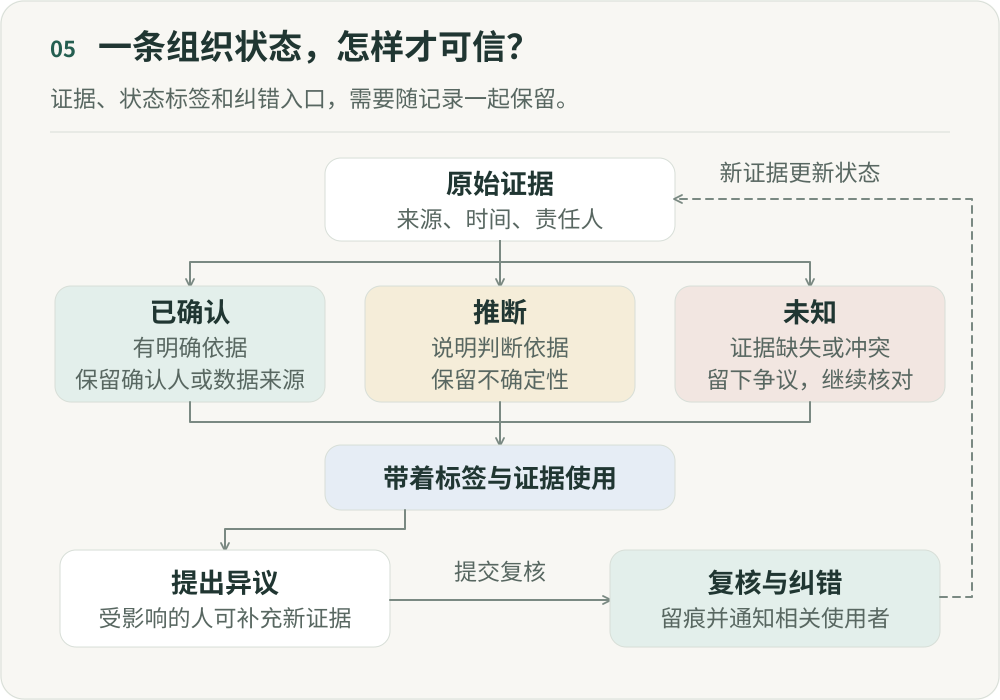

# 谁有权定义组织的事实？

**《重新组织》第五篇｜AI 时代的分工、权力与人的价值**

想象一个普通项目。周一，工程师在群里说：“接口应该周三能完成。”周二的项目会上，负责人说：“目前看问题不大。”到了周三，智能体（Agent）自动生成状态：

> 接口开发：进展正常，截止时间为周三。

管理者没有介入，另一个团队也按周三完成来安排工作。但工程师最开始说的只是“应该”，既没有正式承诺，也没有确认依赖是否解决。

一句带有不确定性的话，从群聊传到会议，再经 AI 摘要写入项目状态，逐渐获得了“组织事实”的外观。没有人在撒谎，组织却已经依据一个并不存在的确定性行动。

这让我觉得，当 AI 开始替组织理解正在发生什么，知识管理之外还有一个问题要回答：谁有权定义什么是真的？

## 一、过去，组织其实没有一个统一的“现实”

我们习惯说数据驱动、统一可信的信息来源、组织知识库。但在复杂组织里，同一个项目往往有好几种状态：工程师认为核心功能已经完成，只差联调；产品经理认为还不能验收；管理者从周报里看到进展正常；业务方却觉得已经延期。

这些人可能都没说错，只是描述了不同维度、时间点和定义下的事实。信息散落在聊天、会议、文档、代码、数据和人的记忆里，需要判断时，大家才聚到一起：“对一下现在到底什么情况。”

很多会议做的就是重新拼出一个大家暂时接受的现实。决策还要在这之后。

## 二、AI 让更多分散信息有机会进入当前状态

Agent 可以持续读取群聊、会议纪要、项目文档、代码提交和业务数据，从中抽取决定、行动、风险、依赖、指标、里程碑与变化。

项目看板、监控和业务系统本来就在维护状态。AI 带来的增量，是有机会把群聊、会议和文档中的非结构化信息也整理进来，让更新更频繁、覆盖更广。前提是信息可访问、含义能被理解，而且系统知道哪些更新需要进一步确认。

当组织状态能够持续更新，周报可能只是呈现它的一种方式，不再是每周重新拼凑出的结果。

## 三、因为 AI 摘要一旦驱动行动，它就不再只是“摘要”

假设 Agent 生成一句判断：“项目 A 当前存在 P1 延期风险。”如果只是给人阅读，错误可能表现为理解偏差；如果系统据此调整资源、通知团队、改变优先级、触发升级，甚至让其他 Agent 修改计划，这句话就在驱动行动了。

我关心的是这类状态怎样成为组织实际据以行动的现实。

第四篇讨论了如何根据目标、当前情况和约束来动态规划并采取行动。这里要继续追问：系统掌握的情况从哪里来？假如它错了，后面的规划越有效，错误就越快进入执行。因此，Agent 可能需要一个可信的状态层，告诉它现在究竟发生了什么。

## 四、最危险的不是 AI 不知道，而是 AI 把“推断”写成了“事实”

“应该可以”“感觉问题不大”“基本完成”“大家好像都同意”“客户应该能接受”——人在沟通中常用这些表达，也通常知道它们还没有得到完全确认。

但把信息压缩成结构化状态时，这层不确定性很容易丢掉：

- “应该周三完成”被记成“截止时间：周三”。
- “目前没看到问题”被记成“风险：无”。
- “大家倾向方案 A”被记成“已决定采用方案 A”。

我愿意把这种变化叫作“推断洗白”。一条推断经过几次摘要、转述和结构化，最终看起来像事实。Agent 需要推断，人也每天都在推断。问题出在传递过程中，我们忘记了它原来只是一个推断。

## 五、组织事实至少应该区分三种状态

如果让 AI 维护组织状态，不能把所有记录都笼统称为事实，至少需要区分：

- **已确认。** 在明确范围和时间内，有可追溯证据支持，并经过所需的核对。例如，“支付接口已经上线”，可以用发布记录和对应环境的监控核对。人的确认应保留依据；“负责人说没问题”不能直接覆盖相反证据。
- **推断。** Agent 根据多条证据推测出的状态，可以辅助判断，但必须让使用者知道它还不是事实。例如，“项目可能延期”，依据是连续三天没有代码提交、两个依赖事项未完成，以及负责人在会议中表达了担忧。
- **未知。** 证据不足或暂时无法判断时，保留缺口。证据之间有冲突，则同时留下争议双方及各自依据，不能用一句“大概率……”替它们作出裁定。

承认不知道，也是组织 AI 需要具备的能力。

## 六、可信的依据，需要一条可以追溯的证据链

过去建立统一的信息来源，常常是找一份文档、一个看板或项目主页，告诉大家“以后以这里为准”。我现在更关心的是，重要状态能否一路追到原始证据：从 AI 摘要找到对应的项目状态，再查到相关决定、指标或事件，以及支持它们的原始记录。

系统说“项目延期概率很高”，我应该能继续问为什么。它说三个依赖事项没有完成，就应该能点开看是哪三个、谁说的、什么时候说的、后来有没有更新。

如果找不到原始证据，这个状态就不应该获得很高的可信度。我们需要的，是让重要判断可以回到证据的系统，而不是一份被当成永远正确的总结。

## 七、但有证据，也不意味着只有一个“真相”

即使拥有更多数据，组织里的重要问题也未必能变成数据库中的客观字段。产品体验好不好、员工表现如何、项目是否值得继续、风险是否严重，都同时涉及事实、标准和价值。

比如，日活跃用户数下降 10% 可以是事实；“产品正在失败”是对事实的解释；“应该砍掉这个项目”则是决定。AI 可以参与这三层，但不能把它们混成“数据表明，我们应该关闭项目”。从数据走到“应该”，中间存在判断标准和价值选择。谁能定义这些标准，本身就是一种组织权力。

## 八、真正的权力，可能越来越表现为“谁能修改组织状态”

除了管多少人、控制多少预算、拥有哪些审批权，AI 时代还可能出现一种需要认真对待的权力：谁可以写入、确认和修改组织状态。

Agent 记录“项目存在重大风险”，负责人可以直接删除，还是只能补充证据？两个团队对同一个依赖事项意见相反，谁来确认？高层说项目没问题，数据却显示风险很高，系统应该记录什么？

这些问题超出了知识库权限管理的范围，涉及整个组织共同依据的现实。当组织状态开始影响决定、资源分配和后续行动，能够修改状态的人，也就在影响这些环节。

## 九、因此，AI 时代的组织记忆必须允许“争议”

我不赞成让组织记忆追求一个完美、统一、没有冲突的答案。产品认为已经就绪，工程认为还不具备条件，业务要求马上上线，风控认为风险不可接受，这些分歧本来就存在。

系统应该能够保留它们，而不是选一个“最可能正确”的观点覆盖其余观点。例如：

> 是否具备上线条件：仍有争议。产品依据验收记录认为功能已就绪；工程认为容量条件尚未满足；风控仍在核对相关风险。三项记录各自保留来源和更新时间。

这里需要组织明确谁来复核、何时处理，以及在争议解除前哪些动作可以继续。记录被修正时，旧状态也应留下变更原因，让已经依据它作出决定的人得到通知。AI 可以帮助暴露分歧，谁有权关闭争议仍需要制度安排。

## 十、从知识库，到组织状态机

知识库回答“我们知道什么”，组织记忆保留“过去发生过什么”。在这之上，AI 原生组织可能还需要一套持续维护当前状态的机制。

它需要说明刚发生了什么变化，哪些事实已经确认、哪些只是推断，哪里有冲突，哪些决定还在等待，以及什么事件应该触发行动。

组织也就有机会从主要按照日程推进工作，转向由重要事件及时触发响应。除了周一周会、月底复盘和季度回顾，系统可以持续维护状态，在出现重大风险、状态冲突、决策逾期、依赖事项受阻或异常指标时，及时把人的注意力拉进来。

## 十一、但这里有一条非常重要的边界：组织记忆不能变成组织监控

读取聊天、会议、文档、代码和数据来重建状态，很容易带来另一个诱惑：是不是也能知道每个人每天干了什么？

技术上越来越容易做到，组织上却可能走错方向。可观测性不等于监控。我们需要观察项目状态、风险、依赖、决定和结果；员工几点开始工作、发了多少消息、写了多少代码、调用了多少次 AI，并不能代替这些信息。

如果组织记忆最后成了员工监控系统，成员就会转而管理自己的数字痕迹。数据越来越多，真实工作却可能越来越难看清。

让工作状态透明，而不是让人成为透明人。这是我想保留的一条边界。

## 十二、谁有权定义组织的事实？

可靠的组织事实，不能仅凭管理者、数据库或 AI 的身份来决定。它需要一个形成和修正的过程：先收集并解释证据，经过确认再写入状态，并在出现新信息时修正。

AI 可以收集证据、发现冲突、提出推断和维护状态。关键事实仍需要明确的来源、可信度、责任人与修正机制，也必须允许被挑战。暂时不知道答案，可以继续调查；错误答案一旦获得事实的权威，就可能带着组织走向错误的行动。

第四篇讨论谁可以决定下一步，这一篇追问决定所依据的现实。决定权规定谁可以行动，维护状态的权力则影响行动依据什么现实。可信的组织状态、清楚的授权和反馈，需要一起工作，系统才有条件维护状态，人也才能把注意力放在需要判断的地方。但信息更透明，并不保证权力更分散。下一篇接着讨论：组织变扁了，权力为什么还可能更集中？

---

## 图解

原始证据应记录来源、时间和责任人。形成状态时，分别标记已确认、推断或未知：已确认有明确依据，推断保留解释与不确定性，未知说明证据缺失或冲突，留下争议意见并继续核对。使用状态时携带标签和证据。受影响的人可以提出异议并附上新证据，由指定责任人复核、纠错、保留修改记录并通知受影响的使用者。新证据再更新状态，不能直接覆盖仍存在的分歧。

作者：LeenMa。原创内容采用 [CC BY-SA 4.0](../LICENSE)。

[文章目录](../README.md) · [上一篇：04](04-policy.md) · [下一篇：06](06-decision-rights.md)
