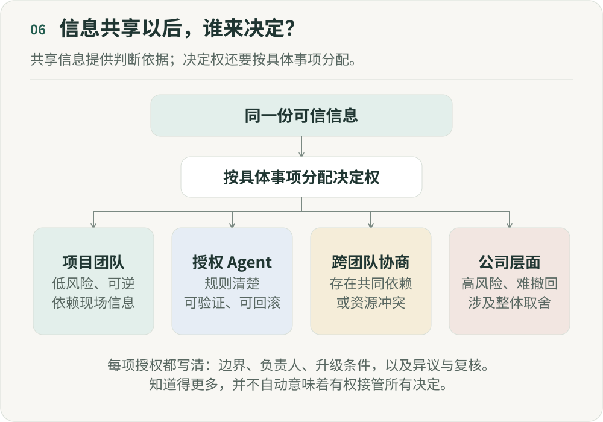

# 组织变扁了，权力却可能更集中

**《重新组织》第六篇｜AI 时代的分工、权力与人的价值**

智能体（Agent）接走协调工作，中层减少；一线员工能力增强，小团队可以端到端完成更多事情；信息自动同步，不再需要层层汇报。这些变化，让“AI 会使组织更扁平”听起来很合理。但层级减少，真的等于权力下放吗？

想象一家拥有完善 AI 系统的公司。CEO 不用每天听十个 VP 汇报，只要问组织管理 Agent：“昨天最重要的五个变化是什么？”系统就能列出延期项目、异常指标、资源冲突和卡住的决定。他再问项目 A 为什么延期，Agent 就调出会议、群聊、代码、数据和项目状态；他想知道调过去两名工程师会怎样，系统还能模拟影响。

过去，一个 CEO 很难理解几百个项目的实时细节。未来如果能够做到，组织图上即使只剩两三层，重要决定也可能更容易集中到少数人手里。

## 一、为什么过去需要分权？

我们经常用“相信员工”“让听得见炮火的人做决定”来解释分权。从组织经济学角度看，还有一个现实原因：上面的人不知道。

一家全国性的零售公司，总部不可能知道每家门店今天发生了什么。CEO 也不可能理解每个客户、每段代码、每次供应异常。信息在现场，很多决定就需要交给离问题最近的人。

知识往往掌握在现场的人手里，这是分权的一个基础。中层和本地负责人除了管理人，还了解总部无法实时获得的现场情况。

## 二、AI 正在改变“知识留在现场”这个前提

第五篇讨论了组织状态。聊天、会议、文档、代码和数据，可以进入一个持续更新的组织状态。项目负责人过去的一项优势，是知道现场发生了什么；未来，这些信息越来越可能被 AI 编码、汇总、解释并向上提供。

一部分现场知识可以被整理成更广泛可读的记录。但未被说出、无法量化或依赖当时情境的知识，仍可能留在现场；记录更完整，也不等于中心理解了全部现实。

Brynjolfsson 与 Hitzig 在《AI’s Use of Knowledge in Society》中提出一个产权理论框架：如果 AI 能把部分本地知识转为可传递的信息，并增强中心的信息处理能力，现场决定者的一部分信息优势就可能减弱。这个推论取决于知识能否有效转移，也不排除仍需分权的情形。[NBER 章节](https://www.nber.org/books-and-chapters/economics-transformative-ai/ais-use-knowledge-society)

AI 因而可能同时带来两种变化：一线更聪明，中心也看得更清楚。

## 三、同一种 AI，可以同时制造分权和集权

Bloom、Garicano、Sadun 和 Van Reenen 在 2014 年发表的研究中，区分了让员工自行获得知识的信息技术，与降低上下级联系成本的通信技术。它们与自主权的关系并不相同。

能够帮助一线直接获得知识、自己解决问题的技术，与更大的自主权相关；而降低人与上级沟通成本的技术，则可能让员工更容易请求上级指令，从而与更集中的决策相关。[研究及发表记录](https://www.nber.org/papers/w14975)

研究对象是 ERP、CAD/CAM 和数据网络等技术，并非生成式 AI。这里借用的是分析问题的线索，不能直接把它的结论搬到今天。

我们可以把 AI 的两种能力拆开看。一方面，一线员工拥有 Agent、数据、知识和工具，能够自己解决过去需要请示上级的问题，由此获得更多自主权。另一方面，管理者可以看到更多项目状态、了解更多背景、比较更多方案，甚至直接指挥执行 Agent，这也可能让决策更集中。

只问组织会不会更扁平，还不足以解释这两种变化。需要继续追问：AI 到底增强了谁的能力？

## 四、最危险的组织，是“表面扁平，实际集权”

我担心的一种情况是：公司减少汇报层级、取消大量中层，让小团队端到端负责；与此同时，所有状态和指标进入统一系统，高层可以随时查看项目、理解上下文，并直接下达任务。

信息传递的层级减少了，决定权却集中起来了。过去，中层承担的一部分判断、过滤和缓冲，随着信息摩擦一起消失。AI 扩大了最高负责人的注意力覆盖范围，让一个人能够看见更多组织活动。

组织可能从层级很多、决策分散，走向层级很少、决策高度集中。后一种结构在图上更扁，权力却未必更分散。

## 五、中层真正被 AI 挑战的，不是“这个人”，而是这个岗位里的不同功能

一个中层通常同时承担信息汇总、进度追踪、任务协调、资源分配、专业判断、冲突解决和人才培养。AI 对这些工作的影响并不相同。

Gulati、Marchetti 与 Puranam 研究了美国企业在 2010—2019 年采用协作工作管理技术的变化，用“管理者监督能力”和“员工需要多少监督”之间的关系解释层级变化。论文于 2026 年发表，但对象并非今天的生成式 AI；这里借用的是它拆解管理功能的视角。[正式发表版](https://doi.org/10.1287/mnsc.2023.04127)

所以，中层岗位更可能发生内部重构。收集信息、同步状态和追踪流程，更容易进入系统；判断、资源配置、冲突解决和人才成长，则需要重新设计。仅用“是否还需要管理者”描述这个变化，会漏掉岗位内部的差别。

## 六、真正的问题不是“谁知道”，而是“谁决定”

即使整个公司拥有同一套可信的组织状态，也不会自然得到更好的权力安排。知道发生了什么，与拥有决定权是两回事。

Agent 可以让 CEO 和一线员工同时看到“项目 A 出现 P1 风险”。接下来，负责人能直接调整计划吗？需要 VP 批准吗？CEO 能随时覆盖负责人的决定吗？Agent 能自动调资源吗？什么情况下需要升级？这些安排，才把共享信息变成了实际的组织权力。

## 七、明确每类决定由谁作出

除了汇报关系，组织还需要说明每类决定由谁作出，以及授权在什么条件下成立。例如：

- **项目团队决定。** 对于可逆、低风险、又高度依赖现场信息的事项，由项目团队直接决定。
- **授权 Agent 决定。** 规则明确、结果可验证、操作可回滚时，Agent 可以在事先约定的边界内自主决定。
- **跨团队协商。** 涉及多个团队或资源冲突时，由相关团队共同决策，或指定一位负责人。
- **公司层面决定。** 对于不可逆、高风险、涉及公司级资源和价值取舍的事项，由公司层面集中决策。

同一张决定权地图，还应写明谁能提出异议、谁负责复核，以及复核期间是否暂停执行。上级覆盖一线决定时，也应记录依据和适用范围，避免授权在口头上存在、每次遇到分歧却被收回。

信息可见性和权限要分别维护。能查看全部订单，并不意味着可以修改所有价格；能够指出规则有问题，也应有明确渠道把意见交到能修改规则的人手里。

## 八、扁平化，还要看决定离问题有多远

过去，我们经常用 CEO 到一线有几层来判断组织是否扁平。我现在更关心的是：一个真实问题出现以后，拥有足够信息且有权行动的人，离这个问题有多远？

如果项目团队掌握全部信息，却每个决定都必须等 CEO，组织图再扁，也不是分权。反过来，一家公司即使有多个专业层级，只要一线团队在明确边界内拥有真实的决定权，也可能有更强的局部自主性。

扁平不等于分权。比起汇报层级的多少，我更想看问题能否交到有条件作出决定的人手里，以及这中间需要经过多远的距离。

## 九、AI 原生组织真正可能出现的，是“中央更强，一线也更强”

走到这里，也许不必在集权与分权之间二选一。我更感兴趣的是：能否让公司层面和一线团队的能力同时增强。

中央拥有更完整的组织状态、更强的资源调度和战略判断能力，用来定义方向、资源边界、行动规则和少数高杠杆决定；一线团队拥有更强的 Agent、更完整的背景信息和明确的自主空间，在边界内感知、判断、执行和反馈。

中心知道得更多，不必因此接管全部决定。这也是第四篇“边界内的自由”在组织层面的展开。

## 十、所以，AI 会让组织更加分权吗？

没有必然答案。AI 可以让知识向下流动，让一线有能力独立解决问题；也可以让信息向上汇聚，让少数人理解和控制更大的组织范围。决定最后走向的，是组织怎样分配决定权。

我更想问管理者的是：AI 让我们看见更多以后，能不能忍住替所有人做决定的冲动？有能力介入，不意味着每次都应该介入。能力不等于权限，这一点同样适用于人。

不必把所有权力下放，也不必让一个超级 CEO 控制所有 Agent。每一个决定，都应尽可能交给掌握足够信息、承担相应责任，同时最接近问题的位置。透明之后是一线获得更多自主权，还是中心获得更多控制权，这仍然是组织的选择。

## 参考来源

- Erik Brynjolfsson, Zoë Hitzig. [AI’s Use of Knowledge in Society](https://www.nber.org/books-and-chapters/economics-transformative-ai/ais-use-knowledge-society), The Economics of Transformative AI；本次依据 NBER 2026 年页面版本。产权理论框架。
- Nicholas Bloom, Luis Garicano, Raffaella Sadun, John Van Reenen. [The Distinct Effects of Information Technology and Communication Technology on Firm Organization](https://www.nber.org/papers/w14975), Management Science, 2014；工作论文发表于 2009 年。研究对象是生成式 AI 之前的信息和通信技术。
- Piyush Gulati, Arianna Marchetti, Phanish Puranam. [Collaborative Work Management Technologies and Managerial Intensity in U.S. Corporations: An Examination](https://doi.org/10.1287/mnsc.2023.04127), Management Science, 2026。研究数据来自 2010—2019 年。

---

## 图解

同一份可信信息可以由项目团队、Agent、跨团队参与者和公司负责人共享。决定权按事项而不是按信息可见性分配：低风险且依赖现场信息的事项交给项目团队；规则明确、可验证、可回滚且已授权的事项可以交给Agent；多团队依赖或资源冲突需要协商并指定负责人；高风险、不可逆或公司层面的价值取舍由相应负责人决定。每项授权都需要明确边界、责任、升级和复核。

作者：LeenMa。原创内容采用 [CC BY 4.0](../LICENSE)。

[文章目录](../README.md) · [上一篇：05](05-live-state.md) · [下一篇：07](07-accountability.md)
