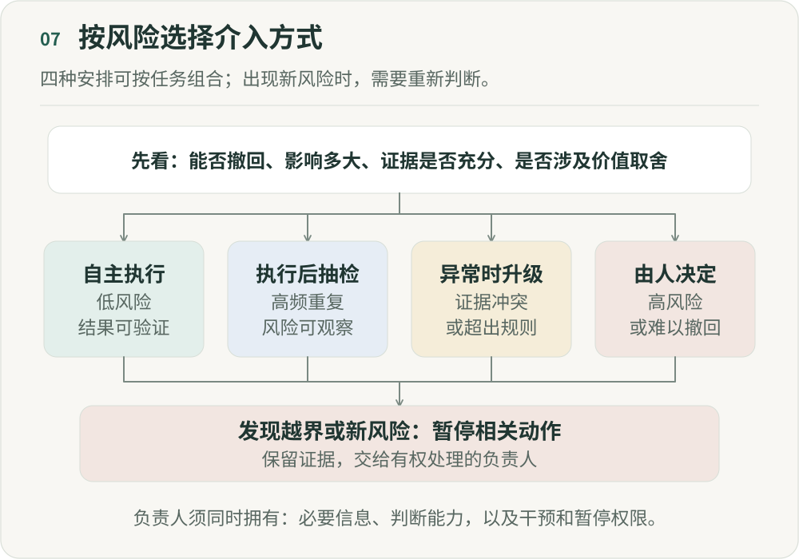

# 当 AI 开始承担工作，谁来承担责任？

**《重新组织》第七篇｜AI 时代的分工、权力与人的价值**

“没关系，最后有人审核。”

这句话听起来让人安心，我却越来越想追问：那个审核的人，实际能控制什么？假设一个智能体（Agent）每天审核 10 万条商品内容，绝大部分自动通过，只有高风险内容交给运营。管理者看到准确率不错，逐渐扩大自动执行范围。某一天，一条严重违规内容被判断为安全并自动发布，组织开始寻找责任人。算法团队说，模型只是给出判断；产品说，规则由业务定义；业务说，每天这么多内容，不可能逐条人工审核。最后，责任落到了系统里那个名义上的审核者身上。

流程上，他是最终负责人。实际上，他每天面对几千条 AI 作出的决定，没有时间了解完整的相关信息和背景，没有参与模型和行动规则的设计，也无法阻止系统的大部分自动行为。他承担责任，却缺少相应的信息、判断能力和权限。

这个人究竟在监督系统，还是只被放在系统最后，用来承担后果？

## 一、“有人审核”不等于“有人负责”

过去，医生看影像、编辑审文章、工程师发布代码、管理者批准预算，判断和行动都由人完成，责任相对容易理解。Agent 则可能接过观察、规划和行动，把人放到最后的审核环节。

表面上，人仍然参与其中。但当自动执行的数量已经超过审核者能够认真处理的范围，大量决定实际上就不会经过逐项人工审核。界面上保留一个负责人，不能弥补处理能力的缺口。

人已经从参与每个决定，转为监督系统的运行。如果直到事故发生后才看到结果，甚至连及时监督都谈不上了。

因此，除了有没有人工审核，还要看：人在什么时候介入，看到了什么，能够改变什么？

## 二、承担责任，需要信息、能力和权限

我越来越觉得，一个人真正承担责任，至少需要三个条件同时成立。

- **知道发生了什么。** 审核者如果只能看到 AI 的“建议通过”，却看不到原始证据、推理依据、历史背景和不确定性，就没有条件独立判断。第五篇讨论可追溯的事实，就是在解决这一层：责任必须建立在可追溯的信息之上。
- **有能力作出判断。** 给一个没有专业能力的人一个“确认”按钮，不会产生真正的监督。判断税务风险，需要理解税务；判断内容质量，需要相应的内容判断能力。否则，人工审核就只是界面上的一个操作。
- **有权改变结果。** 即使知道系统错在哪里，如果无权暂停 Agent、修改决定、回滚操作、调整规则或把问题升级，仍然无法真正承担责任。只分配责任却不给控制权，最后就只是让人承担后果。

这三个条件彼此依赖，缺少任何一个，名义上的负责人都可能无法真正负责。

## 三、根据任务风险，安排人的介入方式

仅仅强调“人在执行环节中”，容易把所有任务都安排成 AI 先做、再由人确认。但生成一张内部会议封面，与自动退款 10 万元，不应该使用同一种监督机制。

需要设计的是人在什么条件下、以什么方式介入系统，至少可以分成四层：

- **自主执行。** 低风险、可逆、结果容易验证的任务，可以由 AI 自主执行，不必逐项确认。例如整理信息、生成内部草稿、低风险代码修改。
- **执行后抽检。** 大量重复、整体风险可控，但需要持续观察质量的任务，可以由 AI 执行，再由人抽检。例如内容分类、数据处理、部分运营任务。人的作用是检查系统是否仍然可靠。
- **异常时交给人。** 遇到证据冲突、超出规则边界、工具失败或经过验证的不确定性信号时，暂停相关动作并交给人处理。模型自报“很有把握”不等于可靠；升级条件还需要独立检查和抽检来补充。
- **由人最终决定。** 对于高风险、不可逆、涉及价值判断或重大责任的事项，AI 可以分析信息、模拟方案、提出建议，但不能拥有最终决定权。例如重大人事决定、公司战略、严重安全事件。

## 四、所以真正重要的不是“人在不在”，而是风险和决定权是否匹配

这接上了第六篇的决定权分配。除了 AI 能不能做，还需要从四个维度判断一项决定应该交给谁：

- **可逆性：** 错了能不能轻易撤回？
- **影响范围：** 影响一个人，还是整个组织？
- **不确定性：** 规则明确，还是存在大量未知？
- **价值判断：** 是在计算最优解，还是在选择我们愿意成为什么？

这些维度需要一起看。单次金额很小的自动退款，累计起来仍可能造成明显损失；可以回滚代码，也不代表已经泄露的信息能够收回。选择介入方式时，还要考虑频率、累计影响和发现错误所需的时间。

## 五、AI 越强，人越不应该审核所有事情

为了安全，很多组织会要求所有 AI 输出都经过人工确认。但当 Agent 持续增加，这种安排会超出人的处理能力。假设一个人管理 20 个 Agent，每个 Agent 每小时产生 20 个决定，一天就有几千次确认。审核很容易变成机械地点击确认，直到事故发生。

自动化监督中存在一种风险：系统长期表现正常，人可能降低警觉，更少主动核对依据。大量低风险决定都要求点击确认，也会把真正高风险的决定淹没在噪声里。增加审核次数，未必增加监督强度。人的注意力应该留给值得独立判断的地方。

## 六、未来真正稀缺的，可能是人的注意力

执行越来越便宜，决定的数量也可能随之增长。过去，一个团队一天做 20 个决定；未来，100 个 Agent 可能每天做 10 万个微型决定。一个成熟专家每天能深度判断的问题，也许只有几十个。此时稀缺的未必是模型调用额度或算力，而是人的注意力。

让机器处理确定性和可逆决定，让系统暴露异常，把冲突、不确定性、高风险和价值选择带到人面前，才能让有限的注意力用于值得判断的地方。第二篇讨论减少低价值协作，这里还需要减少低价值的人工确认。

## 七、最危险的情况，是“人负责，但人无法真正控制”

系统写着“负责人：张三”，出事就找张三。但他没有选择模型、定义行动规则的权力，不知道 Agent 依据了哪些信息，无法修改执行逻辑或暂停系统，甚至没有足够时间检查结果。这样的责任分配并不公平。

责任需要跟着控制权走。Agent 的行为由模型、数据、行动规则、工具权限和平台机制共同决定，就不能把责任全压在最后点击“确认”的人身上。

因此，责任分配需要沿系统结构说明：谁定义目标，谁制定行动规则，谁提供数据，谁授予权限，谁有权干预并改变已有决定，又由谁持续监控。

以开头的内容事故为例，需要先指定一位有权暂停发布并组织处置的人，撤下相关内容、保留当时的证据与规则版本，再分别核查模型判断、规则设计和授权过程。恢复运行也应有人明确批准，不能把一次重新点击“通过”当成问题已经解决。这里讨论的是组织内部的职责设计；具体法律责任仍取决于适用规则和事件事实。

## 八、管理者的工作，也会从“审批”变成“设计监督系统”

传统管理者花很多时间看方案、批预算、审核项目、确认结果。Agent 接走大量低风险判断以后，管理者如果仍是所有事情的审批节点，就可能成为瓶颈。

这时需要设计的是：哪些事情不必找我，何时必须找我；系统要提供哪些信息，我在什么范围内有权干预并改变已有决定；什么信号需要暂停，一次事故之后又怎样更新行动规则。

关注点由单次决定扩展到整个决策系统：让合适的主体，在足够的信息和清楚的边界下作出决定。

## 九、人需要保有治理整个系统的能力

我更愿意用“人治理系统”描述这种关系。人不必参与每一个执行步骤，但需要保有定义目标、设置规则、查看证据、处理异常、暂停系统和修改规则的能力与权力，并承担相应责任。

人的角色由微观操作员转向系统治理者。仅仅在最后放一个确认按钮，还达不到这个要求。

## 十、当 AI 开始承担工作，谁来承担责任？

任务、团队、流程、事实和决定权重新分配之后，责任也需要跟着调整。

谁有能力判断，谁有权行动，谁承担后果，这三者不能长期分离。把责任留给最后签字的人，却不给他信息和控制权，就成了机器有行动权、人有背锅权。

我理解的自治系统，需要知道自己能决定什么、何时必须停下来，以及出问题后由谁负责。人可以从逐项操作和确认中退出，但仍要能够定义方向、设计边界、处理例外，并对自己真正能够控制的事情负责。

---

## 图解

先判断行动是否可逆、影响范围、不确定性和价值取舍。低风险且结果可验证的任务可自主执行；高频重复且风险可观察的任务可执行后抽检；遇到证据冲突或规则越界时暂停相关动作并升级；高风险或难以撤回的事项由人决定。所有模式都需保留暂停、证据保存和升级入口。负责人需要信息、专业判断能力和干预权限。

作者：LeenMa。原创内容采用 [CC BY-SA 4.0](../LICENSE)。

[文章目录](../README.md) · [上一篇：06](06-decision-rights.md) · [下一篇：08](08-incentives.md)
