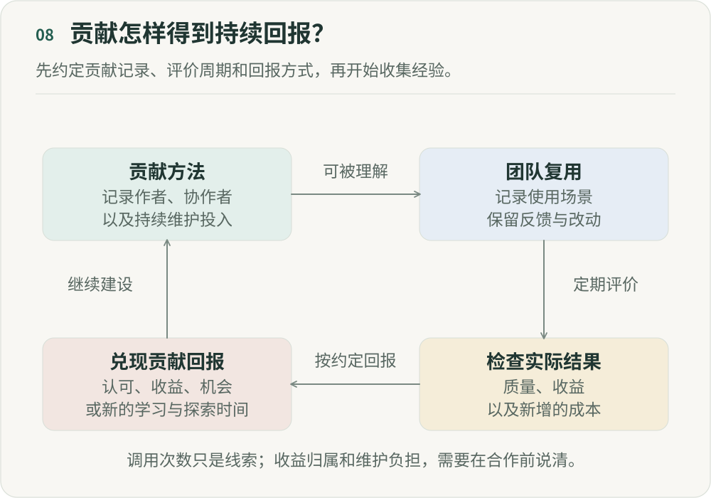

# 把经验教给 AI，员工为什么愿意？

**《重新组织》第八篇｜AI 时代的分工、权力与人的价值**

想象一个工作了八年的运营专家。他清楚什么商品值得投、什么内容有潜力、什么异常意味着风险。团队遇到难题会找他，新人会向他请教。现在，公司希望他把经验写成标准操作流程、整理成案例、标注高质量数据，把判断方法做成技能模块，并不断纠正智能体（Agent），让 AI 学会他的工作方式。

假设半年以后效果很好，过去只有他会做的事情，现在几十个人都能调用 Agent 完成。组织获得了价值，他却开始问：我花八年形成的能力，变成了大家都能调用的公共能力，我自己的价值又在哪里？这个问题得不到回答，知识沉淀就会遇到阻力。

## 一、AI 改变了知识分享的经济学

传统组织鼓励知识共享，但告诉别人怎么做，对方仍需要理解、练习和积累经验。专家分享知识后，通常仍然是专家。

Agent 改变了能力传递的方式。工程师排查故障的方法可以做成每天被调用一万次的技能模块；创作者的审美判断进入系统后，可以同时帮助几百个人；销售的话术、客户判断和策略，也可以持续复用。

知识分享开始包含能力复制：传递的不只是“我知道什么”，还包括“我怎么做”。组织获得了新的复用机会，个人也因此面对新的利益关系。

## 二、组织希望你把自己变得“不再不可替代”

“只有我会”常常是职业安全感的来源：只有我理解系统为什么这样设计，认识这个客户，或者能处理这个流程。

组织不希望依赖一个单点，所以管理者会要求成员把经验传出去。但对个人来说，单点有时也是议价权。AI 放大了这个矛盾：组织期待的已经不只是教会另一个人，而是教会一个可以不断复制的系统。

“如果我把稀缺性全部贡献出去，组织为什么还需要我？”这个顾虑需要通过激励机制设计来回应，不能只解释成不愿意分享。

## 三、真正的问题不是知识共享，而是价值归属

假设一个工程师花三个月构建编程技能模块，此后 500 个工程师每天使用，每人节省 30 分钟。一年下来，它给组织带来了很大的价值。

可到绩效评价时，另一位使用它的工程师交付了 20 个项目，系统记下“交付 20 个项目”；创建它的人因为忙于抽象经验、构建工具和维护能力，只交付了 5 个项目。

如果贡献只按个人交付计算，最理性的选择反而是少做公共能力，多交付自己的项目。

一个人完成的工作，和他让整个组织能够完成的工作，需要被看成两种不同的贡献。个人交付量并不能代表他对组织的全部贡献。

## 四、AI 时代需要重新定义“产出”

项目、商品交易总额、代码、内容和客户，是传统绩效体系容易看到的直接产出。AI 原生组织还会出现另一类贡献：通过能力建设，帮助别人做得更多、更好。

比如，一个技能模块被调用 10 万次，一个 Agent 替团队节省 5000 小时，一套评测让模型迭代更可靠，一个知识库减少重复研究，或者一个专家的方法被 300 人复用。这些贡献的价值，要到他人的工作里才能看见。

评价人才时，可能需要同时问：我直接完成了什么？因为我的建设，别人又能够完成什么？

第三篇讨论判断力如何借助杠杆发挥作用，第八篇接着问怎样认可这种贡献。一个人不应该因为把能力沉淀给组织而失去价值；他创造的杠杆，也应该进入评价。

## 五、但“调用次数”也不是答案

不过，用调用次数、模型消耗量、节省工时和使用人数计算绩效，可能反过来影响人们怎样建设和使用工具。原本用于观察工作的数字，一旦成了奖励依据，就需要检查它是否仍能反映实际价值。

如果技能模块调用量成了目标，贡献者就可能追求更多技能模块、调用和曝光，最后留下几万个没人真正需要的技能模块。因此，评价这类帮助他人的贡献，不能只看使用量，还需要看：

- **持续使用：** 是否有人持续使用？
- **实际结果：** 是否改善结果？
- **可靠性：** 是否稳定可信？
- **跨团队复用：** 是否跨团队产生价值？
- **学习积累：** 是否让组织更容易解决同类问题？

奖励的对象应该是可复用的组织能力，而不只是 AI 资产的数量。

## 六、还有一个更尖锐的问题：效率收益归谁？

设想同样的工作量和质量要求下，一支团队所需的投入从相当于 100 人降到 70 人。这里只用这组假设讨论分配，不把它当作实际测得的提效幅度。组织很容易想到减少投入，但也需要考虑维护系统、处理例外和培养新人的持续成本。

但如果员工每次参与 AI 建设，得到的都是“谢谢你证明这个岗位不再需要这么多人”，下一次再请他贡献经验，他会怎样选择？

AI 转型因此还要讨论：生产率提升以后，收益如何分配。它可以表现为薪酬、奖金、更大的职责范围、更少重复劳动、更多探索时间和职业机会，也可以把节省的能力投入新的增长。

这不意味着所有收益都要直接分给员工，但参与者至少需要看到，帮助组织提效也能让自己获得更好的处境。否则，个人和组织就在朝相反的方向用力。

## 七、让组织获得的能力，也帮助贡献者成长

第三篇提出过一个循环：AI 帮助更多人成长，优秀的人获得杠杆，好方法沉淀成组织能力，再帮助更多人成长。这里需要补上其中的回报关系。

可以在建设开始前就约定几件事：经验整理和维护算不算正式工作，贡献怎样记录，复用后的结果由谁核对，绩效评价如何承认这部分工作，以及节省出的时间或收益怎样使用。复用扩大后，维护投入也要重新讨论，不能一直依靠贡献者业余补洞。

一种可尝试的安排，是由贡献者和使用团队共同记录改进前后的情况，保留失败和额外成本，在约定的周期内复核。回报可以是认可、薪酬、探索时间或新的职责，但应成为能兑现的具体约定。没有足够证据时，就先承认贡献类型，避免把每一次调用硬换算成收入。

如果只有个人向组织贡献能力，却没有组织价值向个人回报的过程，这个循环就无法持续。

## 八、专家的价值也需要重新定义

专家能够解决别人解决不了的问题。AI 时代，他还可能成为组织能力的建设者，让整个组织以后更容易解决这类问题。

工程师除了修最难的 Bug，也可以建立减少同类 Bug 的系统；创作者除了做好自己的内容，还可以把审美标准、参考案例、评测和创作方法交给团队复用；管理者也可以建设一个让更多人作出好判断的环境。

这给专家提供了另一条价值路径：从拥有答案，走向持续创造组织能力。分享不应该让他的价值下降，而应该让贡献作用于更大的范围。

## 九、绩效评价，需要看见不同类型的贡献

“这个结果是谁做的？”会越来越难回答。一条内容可能由创作者定方向、Agent 生成，另一个人构建技能模块，数据团队提供反馈，模型团队改善能力，组织记忆提供所需的背景信息。

比起把每一块商品交易额精确分给某个人，我更倾向于识别不同类型的贡献：

- 直接交付结果。
- 建设可以复用的公共能力。
- 沉淀关键经验。
- 帮助别人成功。
- 作出关键判断。

这些记录应允许贡献者查看和补充；对归属有争议时，由约定的负责人复核。承认不同类型的贡献，也意味着不能把所有价值都归给最后交付的人，或者最容易统计的那个环节。

## 十、把经验教给 AI，员工为什么愿意？

我希望一个专家能得到这样的回答：能力被组织复制以后，你会获得更大的杠杆、更高阶的问题、更广的影响范围，以及与贡献匹配的回报。不要让那些愿意分享方法、让能力被更多人复用的人，反而因此受到惩罚。如果专家必须保持知识私有，才能维持自己的价值，组织就需要检查自己的激励机制。把能力交给系统，应该让人有机会继续学习、解决尚无答案的问题，而不只是让组织证明自己可以不再需要他。

这也留下了下一篇的问题：机器接走已经掌握的工作时，会不会连成为专家所需的练习也一起接走？

---

## 图解

贡献者整理方法并记录创作和维护投入，团队在具体场景中复用并保留改动记录。评价时检查实际结果，包括质量、收益和额外成本，而不只统计调用次数。根据事先约定兑现认可、收益、机会或时间等回报，使贡献者有条件继续建设。回报方式需要协商，不能从调用量直接推导。

作者：LeenMa。原创内容采用 [CC BY 4.0](../LICENSE)。

[文章目录](../README.md) · [上一篇：07](07-accountability.md) · [下一篇：09](09-learning.md)
