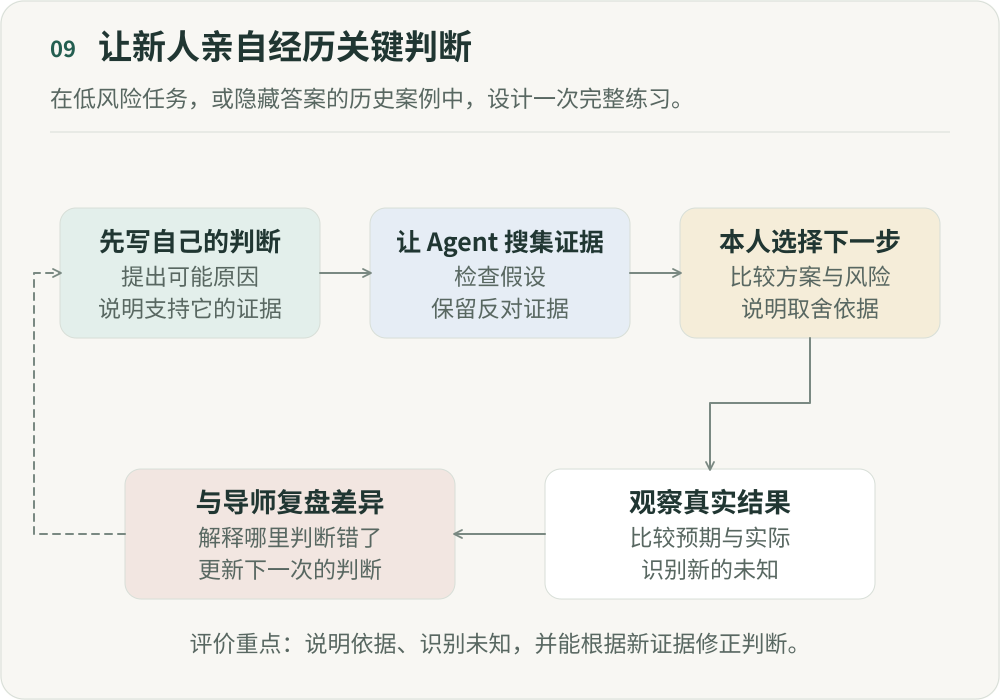

# AI 接走了初级工作，下一代专家从哪里来？

**《重新组织》第九篇｜AI 时代的分工、权力与人的价值**

假设一个刚毕业的工程师加入团队，从修 Bug 开始。先看日志、读代码、猜原因，判断错了就重新排查；改完代码，测试失败，再去理解为什么。一个看似简单的问题，可能折腾一下午。同样的问题交给编程智能体（Agent），它可能搜索代码、定位原因、修改实现、运行测试，十分钟后提交结果。新人审核后合并代码。从生产效率看，这是进步。

但几年以后，如果那些“浪费了一下午”的经历都消失了，他靠什么形成高级工程师的判断力？那些被自动化的初级工作，也许一直承担着另一种作用：它们是上一代专家的训练数据。

## 一、专家不是“学完知识”以后出现的

我们容易把专家理解成拥有更多知识的人：新人知道 100 件事，专家知道 10000 件事。如果只是如此，AI 应该能大幅加速专家培养。但专家的价值往往还在于，看到异常知道先检查哪里，面对三个合理方案能发现潜在问题，或者从完整的需求里识别出被问错的问题。有时数据没有明显变化，他却已经觉得“不太对”。这些能力很难写成一套完整规则。

它们来自做过、犯错、得到反馈、修正，再遇到类似问题的真实经历，逐渐形成隐性知识。人从经验和反馈中识别出规律，再形成判断。知识重要，判断力也需要在现实反馈中训练。

## 二、问题恰恰在于：AI 最先接走的，通常是最适合新人练习的工作

自动化通常从重复、低风险、规则相对明确、容易验证的工作开始。这些也恰好是过去组织交给新人的任务，因为犯错的代价比较低。一个初级工程师不会一入职就设计核心支付架构。一个年轻投资人不会第一天就独立决定十亿美元投资。一个刚入行的医生也不会直接负责最复杂的病例。

许多专业工作中的学徒制和岗位培养，都包含这样的安排：

> **先让你在低风险环境里做大量真实工作，再逐渐把更大的决定交给你。**

但 AI 和新人正在竞争同一类任务。而且从生产角度看，AI 往往更有优势。

这里出现了一个自动化带来的矛盾：最应该被自动化的工作，可能恰好最适合培养下一代专家。

## 三、一项工作的“生产价值”和“学习价值”不是一回事

这要求我们重新定义什么叫“低价值工作”。假设一个高级工程师花两个小时人工排查普通 Bug。这可能确实是低价值工作。因为他已经掌握了这项能力，再做一次几乎没有新的学习。

但同一个 Bug 交给新人，可能是他第一次理解调用链、真正阅读线上日志，或看到一个局部修改如何产生意外影响。从组织生产角度看，这两个小时可能不划算。从人才成长角度看，却可能非常有价值。

所以，衡量一项工作，至少要看它带来了什么产出，以及让执行者学到了什么。AI 很擅长提高生产效率，组织却不能因此忽略学习价值。

如果我们只按照生产价值分配任务，最有效率的结果很可能是：简单任务全部给 AI，复杂任务全部给专家。短期看，产出最大化了；长期看，却出现一个断层：新人没有机会从简单走向复杂。

## 四、最危险的不是新人不会做，而是他“看起来会做”

AI 还会制造一个更隐蔽的问题。过去，一个新人不会写代码，很容易被发现。因为代码就是写不出来。现在他可以让 Agent 写。不会分析数据，可以让 Agent 分析。不了解一个领域，可以让研究 Agent 研究。不会设计方案，也可以先生成三个方向。最终交付甚至可能很好。

于是我们很容易产生一个错觉：这个人成长得非常快。

但交付质量和人的能力需要分开看。一个人借助 AI 交付高级结果，不意味着他已经拥有产生这个结果所需要的高级判断。真正的问题会在异常情况下出现。Agent 给了两个都合理的方案，选哪个？数据与经验冲突，相信谁？系统进入从未见过的状态，怎么办？AI 自己也不确定的时候，谁接手？

如果一个人过去几年主要是在输入提示词、等待生成、接受结果，那么到了真正需要独立判断的那一天，我们可能突然发现：他拥有专家级工具，却没有专家级的判断力。

## 五、所以真正应该保护的，不是“初级工作”，而是“有效练习”

为了培养新人而关闭 AI，让他手工做 AI 十秒钟就能完成的事情，也未必带来学习。需要识别的是：专家形成过程中，哪些经验不应该消失？

例如，排查故障时，真正重要的可能不是亲手敲每一行代码，而是如何形成假设：先检查什么？哪些证据支持这个判断？什么时候推翻原来的假设？如何判断修复没有制造新的问题？如果这些才是学习核心，我们就不需要保留整个旧流程。

需要保留的，是让新人真正面对这些关键判断的机会。

## 六、让新人通过作出判断、获得反馈来学习

传统的“在做中学”，让人在真实工作中遇到问题，通过反馈成长。AI 接走部分执行以后，也许需要更主动地设计判断练习，并让人获得反馈。

比如新人和 Agent 一起排查故障，先由新人写下最可能的三个原因，再让 Agent 搜索证据。接着，由新人决定下一步检查哪里，Agent 执行。最后对照人的判断、Agent 的判断和真实结果，理解差异从哪里来。

练习结束时，带教者可以核对：新人是否提出了可检验的假设，是否找到了能够区分几个原因的证据，何时改变判断，以及是否检查了修复的副作用。评价依据是这些可解释的判断和真实结果，而不是他是否恰好猜中了答案。

如果要观察成长，可以隔一段时间换一道相近但不相同的问题，让新人先独立说明思路。一次好结果不足以证明能力已经形成；在新情境中能否迁移，才更值得继续观察。

## 七、AI 甚至可能让“练习”变得比过去更好

如果设计得好，AI 还可能提高学习密度。过去，新人一年只能经历真实发生的几十种问题；未来，可以取出组织过去十年的真实案例，隐藏答案，让 AI 模拟当时的环境，只提供当时能看到的信息。

新人先作判断，再逐步获得后续信息，最后与真实事件、专家判断和结果对照，理解为什么会这样。案例需要保留当时的信息边界，避免提前透露答案；专家当年的判断也可能有误，不能把历史结果倒写成唯一正确路径。这有点像飞行员的模拟训练：不需要真的制造发动机故障，也能训练如何应对。

因此，不必保留全部低效工作，但要有高质量、接近真实、有反馈的判断练习。

## 八、按能够承担的判断，安排成长阶段

过去，职业成长经常沿任务复杂度展开：新人做小任务，成熟员工负责具体功能，专家负责系统，管理者负责多个团队。AI 时代，我认为可以增加一条成长路径，观察一个人能够承担怎样的判断：

1. **观察判断。** 看 AI 怎样判断，理解它依据的证据和最终结果。
2. **先作预测。** 在 AI 执行之前，先给出自己的判断，再比较两者的差异。
3. **亲自决定。** 由人作决定，AI 提供分析并负责执行。
4. **处理例外。** 接手 AI 不确定、存在冲突或已经失败的情况。
5. **制定规则。** 开始定义其他人和 Agent 应该如何决策。

这是一种可尝试的培养安排，阶段之间可以往返。是否增加权限，应结合任务风险和多次练习的表现，而不是完成一次训练就自动晋级。

## 九、这也意味着管理者必须开始管理“学习债务”

为了今天更快交付，软件工程可能欠下将来要偿还的技术债务。组织也可能欠下学习债务。把任务交给 Agent，今天节省了 2 小时；如果新人也因此失去一次关键判断的练习，这个收益就伴随着未来的人才成本。一次或许影响不大，一千次、持续三年，又会怎样？

当今天的专家离开，中间一代却从未处理过这些问题，债务才会暴露出来。所以除了 AI 的使用情况，管理者还要问：哪些关键判断正在失去训练机会？

## 十、未来人才系统真正应该优化的，不是“做过多少”，而是“判断过多少”

“十年经验”可能意味着同一种任务重复十年，也可能意味着经历过大量不同的问题、判断和反馈。AI 时代，这个区别会更加明显。

我倾向于从三个相互影响的方面理解经验：面对过多少真实判断，获得的反馈有多快、多准确，以及是否反思并理解自己为什么对、为什么错。这比完成过多少任务，更接近专家形成的过程。

## 十一、AI 接走初级工作，下一代专家从哪里来？

过去，真实工作包含大量练习，组织可以在交付中培养人。AI 接走执行环节以后，我们需要主动设计学习机会，让人才成长不再只是工作的副产品。在执行架构、决定权架构和介入机制之外，还需要学习机制：哪些判断必须亲自经历，什么阶段获得多少决定权，需要什么反馈，哪些失败可以先在模拟环境中经历，又怎样判断一个人已经能够从观察别人决策，走向亲自作出决定。

前八篇讨论如何复用人已经掌握的能力，第九篇想补上能力从哪里继续长出来。今天的专家可以获得很大的 AI 杠杆，但如果他们离开时，已经没有人走过成为专家的那条路，组织就失去了能力的来源。

---

## 图解

新人先写下自己的判断和依据，再让Agent搜集证据，然后由新人选择下一步行动。在获得真实结果后，与导师对照预期和结果，解释差异，并修正下一次判断。Agent可以接走搜索与执行，但不能替代新人亲自面对关键选择。评价重点是能否说明依据、识别未知并随新证据改判。

作者：LeenMa。原创内容采用 [CC BY 4.0](../LICENSE)。

[文章目录](../README.md) · [上一篇：08](08-incentives.md) · [下一篇：10](10-agent-management.md)
