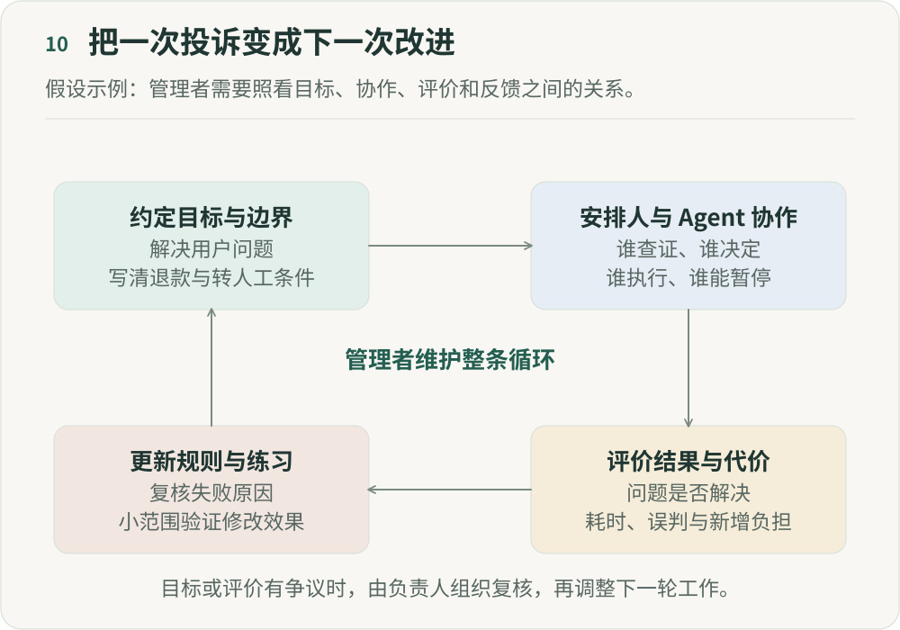

# 当 Agent 成为组织成员，管理者到底在管理什么？

**《重新组织》第十篇｜AI 时代的分工、权力与人的价值**

设想一个处理用户投诉的团队。Agent 可以读取工单、核对订单、检索规则，准备回复和退款建议。客服处理例外，业务负责人决定规则，技术同事维护系统。单看每一步，都像是现有工作变快了。

但工作一旦连起来，新的问题就出现了：回复已经发出，退款却没有成功；系统为了缩短处理时长过早关闭工单；一条规则改过了，另一个 Agent 还在使用旧版本。团队需要管理的，已经包括这些执行者之间的关系。

这里把 Agent 称为“组织成员”，是从协作角度作的比喻。它可以接收任务、使用工具、留下记录，但没有因此获得与人相同的法律身份或自主利益。它能够做什么，仍由组织配置的目标、信息和权限决定。我更想讨论的是，管理者怎样让这些安排持续有效。

## 一、先说明这件工作为什么值得做

投诉处理的目标可以是尽快解决用户问题，但“尽快”并不足以指导所有行动。核实事实、遵守退款规则、保护用户信息、给用户合理的复核机会，也都需要进入目标。

假设系统把“关单时间最短”当成唯一标准，最容易优化的可能是尽早关单。工单结束了，问题却可能转移到下一次投诉。管理者需要说明哪些结果可以互相权衡，哪些条件必须满足，以及发生冲突时由谁决定。

这一点也适用于人。客服知道一条规则正在伤害用户，却没有渠道推动修改，系统就只能反复处理同一类例外。定义目标应当是可以被反馈影响的工作，而不只是一次配置。

## 二、安排协作，先把交接条件说清

Agent 数量增加后，任务也可能自行膨胀。一个执行者发现缺口就继续拆任务，另一个为了提高质量不断追加检查，最后每一步都有理由，却没有人判断继续做是否值得。

投诉处理里，可以先规定几个交接条件：信息收集到什么程度才形成建议，出现相反证据时交给谁，等待补充材料时是否暂停计时，用户没有回应时怎样处理。需要处理同一订单的几个 Agent，也应共享一致的记录，避免重复退款或给出相互矛盾的答复。

管理者需要照看的是整件事的进展。一次回复写得很好，但后续动作没有执行，仍然没有完成工作。任务分配因而要同时说明输入、输出、下一位接手者，以及结束或停止的条件。

## 三、工作环境，需要有人持续维护

同一个模型，能读取的规则不同、工具是否可用不同，表现也可能不同。给 Agent 一个退款工具，还需要说明它能处理哪些订单、在什么范围内操作，以及如何确认操作已经完成。

前面几篇讨论的事实、授权和责任，在这里变成日常维护：规则过期由谁更新，工具报错由谁处理，哪些数据可以读取，权限何时复核，谁能撤回错误配置。这些工作需要明确负责人和投入，不能在上线以后默认它们会自行保持正确。

系统还应保留足够的运行记录，让负责人能够还原一次决定：当时看到了什么证据，使用了哪版规则，执行了哪个动作，结果是否得到确认。日志的目的应是理解工作和修正系统，访问范围也应与这个目的相称。

## 四、评价需要同时看结果和代价

回复速度、解决率、用户反馈、错误补救和人工处理时间，可能指向不同方向。速度提升，但客服要花更多时间处理被误关的投诉，收益就需要重新计算。

我会先为同类工作说明怎样记录结果，再看自动处理前后发生了什么变化。工作量、难度或用户类型不同，就不能把两组数字直接归因于 Agent。没有足够证据时，可以先报告观察到的变化和未解释的部分。

评价还需要允许异议。客服认为一次处理不合理，用户认为结果不公平，都应有办法进入复核。指标可以帮助发现问题，却不能替组织完成全部价值判断。复核也可能发现评价标准本身需要修改。

## 五、异常出现时，要有人接得住

“遇到问题转人工”常被写成一条完整的规则，真正运行时却还差很多条件：转给谁，对方何时能接手，等待期间系统还能做什么，超时以后谁负责处理？

在投诉场景中，证据冲突的工单可以暂停退款建议，并保留当前信息交给负责人复核。已经执行失败的退款，则要先查明支付状态，避免重复提交。两种情况需要不同的处理方式。

异常数量持续增长时，不能只要求客服加快处理。管理者需要判断是规则覆盖不足、工具故障，还是自动处理范围过大，并有权暂时缩小范围。一次工作的运行状况，也应包括接手者是否已经超出负荷。

## 六、反馈不会自动变成学习

MiMo-V2.6 的官方训练说明把任务环境、运行框架、评价和反馈放在一起讨论。这给我一个有限的启发：能力能否改善，与它获得什么反馈有关。[MiMo 官方说明](https://mimo.mi.com/docs/en-US/news/latest/v2-6)

但模型训练与组织学习有明显区别。真实业务的结果可能很晚才出现，也很难归因到单个动作；员工、用户和管理者对“做好”的理解也可能不同。一次满意度下降，不能直接当成一条明确的训练信号，更不能让系统自行修改所有规则。

要让投诉经验进入下一轮工作，可以先把重复错误归为一个待改进问题，再由负责人检查原因，修改相应的规则、工具或资料。在历史案例上检查修改是否造成新的错误，小范围使用，保留原版本和撤回办法，最后再决定是否扩大。

这里的“学习”可能只是修正一条规则、补充一个反例，或让新人理解一次判断，并不必然涉及模型训练。记录留存只是起点，谁审核、谁修改、怎样验证和撤回，都需要有人负责。

## 七、系统改进也要让人受益

如果 Agent 接走了简单问题，客服只剩下情绪强烈、证据复杂的投诉，工作数量下降也可能伴随负担上升。评价效率时，需要把这种变化算进去。

贡献经验的人也需要时间维护方法，并得到相应认可；新人需要在适当支持下练习判断，不能只接收最难、最急的例外。这分别对应第八篇的贡献回报和第九篇的学习机会。

管理者可以和团队一起检查：自动化减少了哪些重复劳动，又增加了哪些隐性工作？谁获得了时间，谁承担了压力？规则的修改是否听到了这些人的意见？这些问题会影响团队是否愿意继续合作，也会影响系统所依赖的信息是否真实。

## 八、管理者需要持续检查什么

回到开头的投诉团队，我会把管理工作的重点放在几件具体的事情上：目标冲突有没有被处理，交接是否完成，异常是否有人接手，成本是否转移给了别人，以及复盘是否改变了下一轮工作。

这不意味着管理者要亲自维护每个工具、查看每条记录。可以把职责交给合适的人，但需要保证这些职责有资源、有权限，也能在冲突发生时找到决定者。

人和 Agent 的分工会随着能力变化不断调整。比起一次设计出完美的系统，我更看重团队能否及时发现失效的安排，并共同把它改过来。第十二篇的五张地图，就是把这些检查放回一条具体工作链路的方法。

## 参考来源

- Xiaomi MiMo. [MiMo-V2.6: Scaling Up Reinforcement Learning for Self-Improvement](https://mimo.mi.com/docs/en-US/news/latest/v2-6)，访问于 2026-10-10。官方训练说明；本文只借此讨论反馈条件，不用它证明组织管理的成效。

---

## 图解

处理投诉前，约定解决用户问题的目标及退款、转人工等边界。再安排谁查证、谁决定和谁执行，使人与Agent分工清楚。完成后评价用户问题是否解决，并记录耗时、误判和新增负担。经复核的失败原因用于更新规则与训练案例，小范围验证后进入下一轮工作。目标或评价发生争议时，需要由负责人组织复核，不能只优化单一指标。

作者：LeenMa。原创内容采用 [CC BY 4.0](../LICENSE)。

[文章目录](../README.md) · [上一篇：09](09-learning.md) · [下一篇：11](11-firm-boundaries.md)
