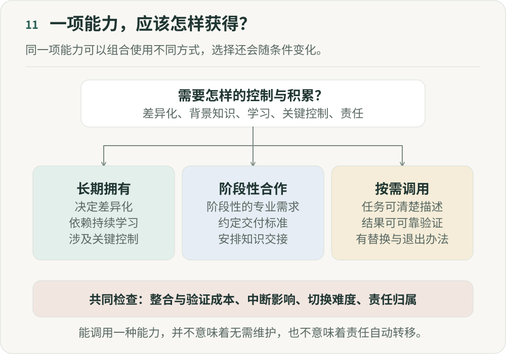

# 当能力都可以调用，我们为什么还需要公司？

**《重新组织》第十一篇｜AI 时代的分工、权力与人的价值**

过去，做一个产品需要找到产品、设计、前后端、算法、数据和运营。如果这些能力会被长期使用，把人招进公司，往往比反复寻找、建立信任、沟通和协作更合适。公司把未来反复需要的能力提前组织起来。智能体（Agent）正在改变其中一部分前提：研究可以调用研究 Agent，开发可以调用编程 Agent，视觉可以调用生成模型，专家的方法也能沉淀成技能模块，供整个组织使用。

当越来越多能力可以随时调用，我们为什么还需要把那么多人长期组织在一家公司里？

## 一、公司为什么会存在？

Ronald Coase 在 1937 年的《The Nature of the Firm》中，从使用市场的成本解释企业为何存在。发现价格、谈判、订约和检查履约都需要投入；把一部分协作放到企业内部，有时可以减少这些成本。但内部管理同样有成本和局限，需要比较不同安排。[原作](https://doi.org/10.1111/j.1468-0335.1937.tb00002.x) · [Coase 本人的回顾](https://www.nobelprize.org/prizes/economic-sciences/1991/coase/lecture/)

公司因而把一部分高频协作放到内部，让工程、设计等长期需要的能力不必每次重新购买。从这个角度，我把公司理解为一个稳定的能力容器。

过去，公司的能力边界很大程度上也是人员边界：需要什么能力，就招聘什么人。AI 正在把两者拆开。

## 二、人数之外，还要看能够调用哪些能力

软件、设备和外部服务早已让能力增长不必完全依赖增员。AI 扩大了其中一部分选择，让更多认知任务也能按需交给外部工具和服务完成。

模型、Agent、技能模块、软件接口和工作流带来了不同的获取方式。工程师的方法可以变成技能模块，团队的研究流程可以变成 Agent，通用能力可以通过软件接口获得。

人数不能单独说明生产能力。同样规模的团队，拥有不同的数据、工具、基础设施和外部服务，能够承担的任务会很不一样。是否能够可靠交付，还要看这些能力怎样组合以及谁负责检验结果。

组织设计因而需要在“招多少人”之外，回答“需要控制哪些能力”。

## 三、未来组织真正需要做的，是决定哪些能力必须长期拥有

沿着调用能力的思路，很容易想到“一人公司”：模型用外部的，设计交给 Agent，开发使用编程 Agent，运营自动化，最后只保留几个人。

但能从外部获得，与应不应该长期拥有，是两个问题。有些能力即使买得到，也可能决定产品差异、核心判断、用户关系、数据优势和长期学习速度，值得组织持续掌握。

比如，AI 公司可以调用外部模型；但如果它的竞争优势来自模型能力，完全不掌握模型，就可能把核心能力交到别人手里。讨论组织边界，需要判断哪些能力必须由自己控制。

## 四、区分长期拥有、阶段性获得和即时调用

我越来越倾向于从三个层次理解未来组织的能力来源：

- **长期拥有。** 决定公司差异化、长期竞争力和关键判断的能力，需要持续积累背景知识、数据、判断经验和反馈。例如核心产品判断、关键技术能力、用户理解、品牌与组织记忆。这些能力不能每次从零购买，价值来自长期积累产生的复利。
- **阶段性获得。** 法律咨询、特殊设计、某个阶段的行业专家、一次性的复杂工程能力，都可能非常专业，但组织并不是每天需要。过去通过顾问、外包和合作伙伴解决，AI 会进一步降低这部分能力的获取成本。
- **即时调用。** 研究、编程、翻译、数据分析、视频生成等能力，越来越可以像云计算一样，按需要调用、按用量获取，不必长期绑定一个岗位。

三种安排可以共存，也可以随任务变化。同一个团队可以调用通用模型，同时长期维护自己的数据、评价标准和用户关系；“使用外部能力”不等于把与它相关的全部判断都交出去。

## 五、值得长期拥有的，未必是最贵的能力

很多组织会自然认为：越高端、越昂贵的能力，越应该自己拥有。我认为还要看五个问题：

- **是否决定差异化？** 所有竞争对手都能调用的能力，很难成为长期壁垒。
- **是否依赖持续积累的背景知识？** 如果每次执行都需要大量公司内部历史、用户理解和隐性知识，外部调用的成本会很高。
- **学习能否不断积累价值？** 这项能力是不是越做越懂用户、越做越形成数据、越做越产生新的判断？
- **是否涉及关键控制权？** 一旦外部能力不可用，公司还能不能运行？
- **是否承担不可转移的责任？** 有些决定可以委派执行，但责任主体不能被外包。

还要把调用成本算完整：接入和验证需要多少投入，服务涨价或中断怎么办，数据和记录能否迁移，换一家供应方要重做哪些工作。调用价格低，并不保证整体成本低。对于关键能力，可以先验证替代路径，再决定依赖到什么程度。

综合这些问题，长期投入应优先支持能够积累价值、并影响关键控制权的能力。

## 六、这会让公司变得更小吗？

有可能，但不能直接推断公司会因为 AI 越来越小，最终走向一人公司。AI 降低了一部分生产成本和协调成本，也可能让组织承担更大的目标。

过去 20 个人做一个产品，未来可能同时运营十个产品。人数没增加，业务范围却扩大了。新的商业机会变得可行后，公司甚至可能继续招聘。

团队变小，不等于公司变小。大型组织可能由许多小型核心团队组成，共享模型、Agent、技能模块、数据、基础设施和渠道。公司除了容纳人员，也为这个能力网络提供支持。

## 七、那为什么这些小团队还要属于同一家公司？

即使团队更独立、能力更容易调用，也不意味着它们都应该成为独立公司。有些条件不会因为 Agent 出现就自动变便宜：

- **资本：** 谁承担长期投入和失败风险？
- **渠道：** 谁拥有用户、渠道和市场入口？
- **品牌：** 用户为什么信任你？
- **数据：** 哪些背景知识需要长期业务积累？
- **基础设施：** 哪些能力只有规模化共享才经济？
- **责任：** 谁承担法律和社会责任？
- **共同目标：** 为什么这些人愿意连续几年投入同一个方向？

市场可以完成一次交易，困难的创新却常常需要长期、连续、无法事先写清合同的共同投入。AI 降低一部分交易成本，并不会自动消除这些组织需求。

## 八、公司真正的边界，可能从“谁是我的员工”变成“什么必须由我控制”

过去，员工在公司边界里面，供应商和市场在外面。现在，一个外部模型、员工创建后全公司使用的技能模块，或者合作伙伴持续运行的 Agent，应该算内部还是外部能力？这条边界正在变得模糊。

除了雇佣关系，还需要看控制权的边界：什么目标由组织定义，什么数据由它掌握，什么能力由它持续积累，哪些决定权属于它，又由它承担什么结果。这些控制权和责任，也在构成组织的边界。

## 九、这也会重新定义“核心团队”

过去说核心团队，通常指 CEO、产品、技术、设计和运营负责人。未来，也许还需要从掌握什么判断和控制权来看。

定义问题、作出判断、设定评价标准、掌握组织独有的背景知识和关键决定权，这些能力决定了做什么、什么叫好、什么不能做，以及哪些能力需要积累。掌握这些能力的人，可能构成判断核心，其他执行能力则在核心之外动态组织。

一个很小的核心团队，可以连接很大的能力网络。这比“一人公司”更接近我理解的未来。

## 十、当能力都可以调用，我们为什么还需要公司？

因为能力的获取方式变化了，长期积累背景知识、承担风险、建立信任、掌握关键资源和形成共同判断，仍然需要有人组织。更难交给一次交易解决的，是哪些事情值得长期一起做，以及怎样让积累的能力持续产生价值。所以我并不认为 AI 必然让公司消失。但公司的边界需要重新审视：哪些能力必须属于我们，哪些只需要使用，哪些绝不能失去控制？长期拥有、阶段性获得和即时调用，是帮助作出这些判断的三种安排。

前十篇讨论公司的内部，第十一篇把视线放到了边界。最后剩下的问题也更实际了：既然任务、流程、权力、责任、学习和公司边界都可以重新设计，我们今天从哪里开始？第十二篇回到真实团队，从一件工作开始。

## 参考来源

- R. H. Coase. [The Nature of the Firm](https://doi.org/10.1111/j.1468-0335.1937.tb00002.x), Economica, 1937。
- Ronald H. Coase. [The Institutional Structure of Production](https://www.nobelprize.org/prizes/economic-sciences/1991/coase/lecture/), Nobel lecture, 1991-12-09。作者对市场与内部协调成本的回顾。

---

## 图解

先判断一项能力需要怎样的控制与积累，再选择长期拥有、阶段性合作或按需调用。决定差异化、依赖持续学习或涉及关键控制权的能力值得持续拥有。阶段性专业需求可以合作，但要约定交付与交接。能够清楚描述、可靠验证和替换的能力可以按需调用。无论哪种方式，都应检查整合与验证成本、中断影响、切换难度和责任归属。

作者：LeenMa。原创内容采用 [CC BY 4.0](../LICENSE)。

[文章目录](../README.md) · [上一篇：10](10-agent-management.md) · [下一篇：12](12-five-maps.md)
