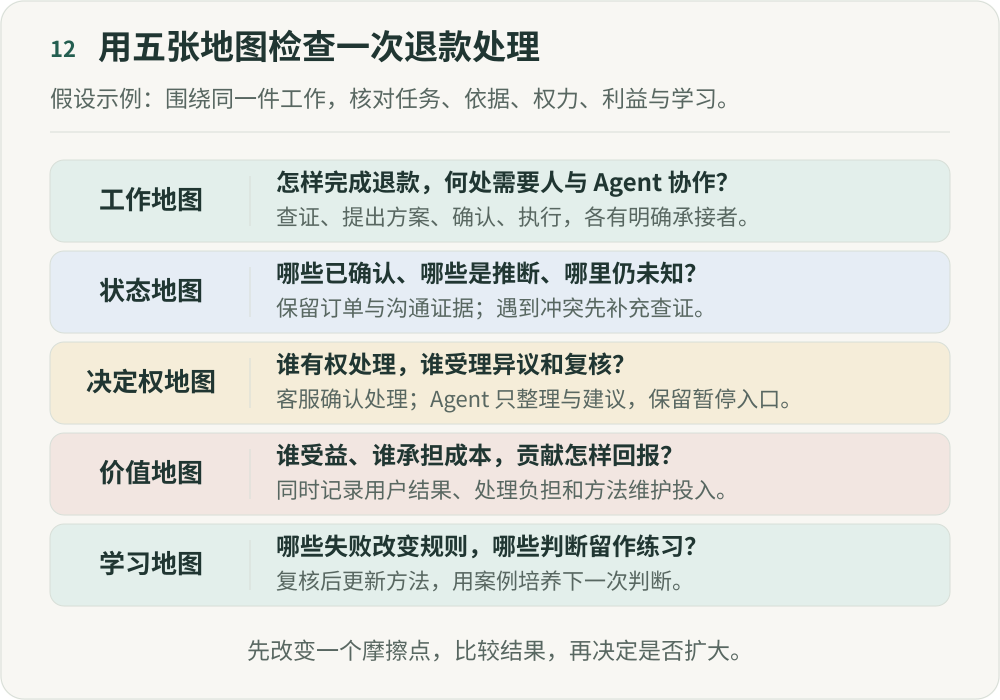

# 不要先改组织架构：如何真正开始「重新组织」

**《重新组织》第十二篇｜终篇**  
**AI 时代的分工、权力与人的价值**

写到最后一篇，我想把前面的讨论放回一件具体工作。任务可以重新分配，事实需要核对，决定权要与责任相称，贡献和学习也不能被遗漏。明天回到团队，可以怎样开始？

我建议先选一条正在发生的工作链路，用五张地图看同一个问题。这里的“地图”，可以是一页表格或一张白板；它们帮助我们把容易分开讨论的事情放到一起，并不要求先建设一个平台。

下面贯穿使用一个**假设示例：处理一位用户的商品损坏投诉**。它用于说明怎样填写和讨论，没有对应的真实公司，也没有已经测得的提效结果。

## 一、先选一件边界清楚的工作

“改造客服部门”太宽泛。可以先把范围定为：收到商品损坏投诉，核对材料，形成处理建议，由客服确认，执行后告知用户，并保留复核渠道。

在这个示例里，Agent 可以读取所需的订单信息、整理用户材料和起草建议；试行阶段不直接退款。客服确认处理方案，业务负责人处理规则之外的争议，技术负责人处理工具故障。

这是一次设计选择，并不代表所有投诉都应这样处理。先把目标、参与者、允许读取的信息和暂不处理的情况写清，后面才有共同的讨论对象。

## 二、工作地图：看清任务和交接

沿着这次投诉，把实际动作列出来：接收材料、查询订单、核对处理规则、提出建议、确认执行、通知用户、处理复核。每一步都要说明由谁负责，以及什么情况才算完成。

例如，“已生成退款建议”只能交给客服判断，不能直接记成“退款完成”。支付系统返回成功后，还需要核对对应订单与退款记录，才能进入通知环节。缺少这一步，回复和真实动作就可能分开。

工作地图还应记录等待和返工。客服为什么需要重复询问，材料在哪里丢失，哪些交接只是在复制信息？先找到一个明确的摩擦点，再决定是否值得让 Agent 介入。

## 三、状态地图：保留依据和不确定性

用户上传一张包装破损照片，并不自动证明商品损坏发生在哪个环节。订单已签收是一个有记录的事实；损坏原因可能仍未知；是否符合某条退款规则，还需要结合其他材料判断。

状态地图可以记录每项重要信息的来源、时间、确认者和争议。已经确认的事实、根据证据形成的推断、暂时未知的部分，要让接手者能分清。

信息变化以后，还需要知道谁被影响。用户补充了新照片，先前建议就可能失效；订单系统修正了退款状态，客服和后续 Agent 都应该看到更新。地图要帮助我们找到这些依赖，避免旧结论在别处继续驱动行动。

## 四、决定权地图：说明谁能决定，也说明怎样复核

在这个试行安排中，Agent 可以请求缺少的材料、整理依据和提出建议；客服在既有授权范围内确认处理；超出规则或证据相互冲突时，由业务负责人复核。退款动作仍通过现有的授权渠道完成。

每类决定还要补上停止和升级条件。无法核对订单时暂停相关操作；支付状态不明时先核查，避免重复退款；工具故障由技术负责人接手。这里的“转人工”必须指向实际能接手的人。

用户可以要求复核，客服也可以对系统建议提出异议。复核期间哪些动作暂停、谁给出结论、怎样记录原因，都要写清。授权如果只有“谁可以做”，缺少“谁可以挑战和纠正”，就还不完整。

## 五、价值地图：同时看结果、代价和分配

处理更快只是一个观察角度。还需要看用户问题是否解决，建议是否准确，是否发生重复退款、重新投诉或额外返工，以及客服花了多少时间纠正系统。

这些指标要有一致口径。例如，处理时长从哪个事件开始、到哪个事件结束，用户补材料的等待是否单独记录；重新投诉观察多长时间，哪些情况算同一个问题。没有约定口径，就很难比较前后变化。

这一张图还要接住第八篇的问题：谁获得了收益，谁承担了成本？若信息整理变快，却把更多复杂投诉集中给少数客服，平均时长可能掩盖负担的转移。贡献规则和案例的人，也需要正式的维护时间与认可。

在示例中，可以先约定把整理和维护纳入工作安排，共同复核节省时间和新增负担，再讨论如何使用这部分余量。这里记录的是需要落实的分配安排，不能用“未来会有更大成长空间”代替具体回报。

## 六、学习地图：留下能影响下一次工作的经验

这次投诉结束以后，值得留下的可能是一次误判的原因、一条规则的歧义，或一段帮助新人理解证据的材料。不是每条工单都需要长篇复盘，重复出现或影响较大的问题应能被找到。

把问题写进文档还不够。谁负责修改，怎样检查，何时生效，使用旧版本的人怎样获知，都要落实。在这个示例里，规则负责人审核修改，用历史案例检查影响，再由客服小范围试用；出现新的错误时，可以恢复原规则。

新人也可以先对经过处理的案例独立判断，再与当时证据、专家意见和实际结果比较。案例应隐藏后续答案，只提供当时能够获得的信息。训练材料需要去掉不必要的个人信息，并取得相应使用授权。

学习地图要让我们看见两种积累：工作系统怎样改善，人的判断力怎样成长。两者都需要投入，也都不能只靠“经验已经存进知识库”来证明。

## 七、五张地图画完，只改一个地方

在这个假设示例中，我们暂时选择的改动是：让 Agent 整理订单和投诉材料，给客服提供带来源的建议草稿。决定权和退款执行渠道先沿用现有安排。这样比较容易观察信息整理是否有用，以及它是否增加了核对负担。

试行前，先记录现有工作的情况，约定负责人、观察周期、参与范围和停止条件。出现关键事实混淆、敏感信息越界或无法还原处理过程时，暂停这项改动，由负责人核查。日常检查的数量和频率应根据工作量与风险另行确定。

一次只改变范围清楚的部分，更容易解释观察结果。如果同时更换模型、调整人员、重写规则和改变考核，即使数字改善了，也很难判断原因。

## 八、怎样知道这次改变值得保留

把试行前后可比较的工作放在一起，观察结果、成本与副作用。任务类型和复杂度不同，就分别记录；无法解释的变化保留为未知，不急着归因于 AI。

以投诉处理为例，可以检查材料整理是否更完整、建议是否减少了反复查找、处理时间怎样变化、错误和复核有没有增加，以及贡献者和使用者的负担是否合理。这里没有通用的及格线，团队需要事先说明什么样的变化足以支持继续试行。

若节省的时间小于核对和维护投入，就可以缩小范围、调整方法或撤回。失败记录也有价值：它告诉后来的人，这个方法在什么条件下不值得使用。

## 九、让结果告诉我们下一步

五张地图是观察工作运行的五个视角，不能替代全部组织制度。正式职责、劳动关系、专业资质和必要的管理安排，仍要在各自范围内明确。

它们的作用，是帮助我们讨论一处变化怎样影响其他地方：信息更快了，决定权是否清楚；执行更便宜了，检查成本是否上升；经验被复用了，贡献者和新人是否也能受益。

《重新组织》没有一张适用于所有公司的未来架构图。我更希望这套文章能留下一个可以共同修订的起点：选一件真实工作，把依据、权力、代价和学习放在同一个讨论里，再做一次有边界的改变。

如果你试过，记录下场景、改动、结果和失败；如果你不同意，也把反例和理由留下。具体的实践会帮助我们知道，哪些判断成立，哪些需要修改。我们一起工作的方式，也可以在这个过程中继续变化。

**《重新组织》第一季 · 完。**

---

## 图解

工作地图检查退款怎样完成以及人与Agent怎样协作。状态地图区分已确认、推断和未知，并保留订单与沟通证据。决定权地图明确谁有权处理、谁受理异议和复核。本次试行由客服确认处理，Agent只整理材料和建议，不退款、不关单；规则外由业务负责人复核，并保留暂停入口。价值地图检查谁受益、谁承担成本、贡献怎样回报，并同时记录用户结果、处理负担与维护投入。学习地图检查哪些失败改变规则、哪些判断成为新人练习。先改变一个摩擦点，比较结果，再决定是否扩大。

作者：LeenMa。原创内容采用 [CC BY-SA 4.0](../LICENSE)。

[文章目录](../README.md) · [上一篇：11](11-firm-boundaries.md)
